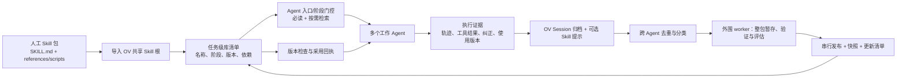

# 多 Agent Skill 库的进化、管理与共享

> **第一版方案（2026-10-10）**：选择 [`main` 上的 Skill evolution detour](ov-skill-evolution-detour.md)；本文保留能力与接口清单，具体接入点和验收边界以 detour 文档为准。[`feat/train_opt` 分支复核](train-opt-skill-evolution-review.md)用于解释 Experience 能力边界，并非第一版实施路线。

> 现状依据：2026-10-10 的 OpenViking 仓库实现。本文是面向“多个 Agent 共同完成同一类任务”的接入设计与缺口清单，不表示下述编排组件已经实现。

## 结论

OpenViking（下称 OV）已经提供 **Skill 包存储、检索、整包更新、会话归档与记忆提取、快照** 等基础能力。它还没有一条可直接启用的链路，能稳定地把多个 Agent 的轨迹和人工纠正变成同一套共享 Skill，并确保所有运行中的 Agent 使用新版本。

第一版在 OV `main` 上增加一个窄的 Session Skill 候选出口，并在外围实现**任务级 Skill 库管理层**：它统一接收归档证据与可选 Skill 提示、查重和审查，在隔离目录编辑完整包，串行发布库版本，并要求各 Agent 在明确的决策边界检查版本、加载所需 Skill 和引用文件。OV 负责归档、候选提取、正式包存储和整包 API；外围服务负责跨 Agent 的提案与发布，Harness 负责实际采用。

## 目标链路



这里的“同步”分三层：**OV 中的文件已更新**、**Agent 已获知库的新版本**、**Agent 已把新版本用于后续决策**。OV 的写入和索引只完成第一层；后两层需要 Agent Harness 配合。已发起的工具调用无法靠更新 Skill 文件追溯改变。

## OV 已有能力与边界

| 环节 | 当前状态 | OV 能提供什么 | 尚缺什么 |
| --- | --- | --- | --- |
| 人工 Skill 与引用文件导入 | 已具备 | 目录、ZIP、Git 等整包导入；私有根 `viking://user/{user_id}/skills/` 或账户共享根 `viking://agent/skills/`；处理 L0/L1 摘要与附件索引 | 一组 Skill 共同服务某任务的**库清单**和阶段规则 |
| 运行时发现和读取 | 部分具备 | 列表、语义查找、读取 `SKILL.md`、附件 URI 与包 `revision` | “这个阶段必须加载哪些 Skill”的确定性门控；只靠模型主动查询会漏读 |
| 轨迹和人工纠正采集 | 部分具备 | Session 可写入消息及工具记录，commit 后归档；Agent Evolution 可由 case/trajectory 提炼 experience | 候选须显式关联任务、Agent、人工纠正、当时已读取的 Skill 版本及完整证据 |
| 自动提议新 Skill | 实验性/部分具备 | 可配置会话 Skill 提取，走内部 Skill policy 更新链路 | 默认关闭；现有提示侧重用户持久规则；没有完整的跨 Agent 提案审查与包附件维护 |
| 重复 Skill 识别 | 部分具备 | `skills/find` 可找相似 Skill；内部 patch merge 设计会读取已有内容 | 中央去重、幂等键、区分“已有但未读”和“真正新问题”；当前内部 Skill 候选查找有实现缺口，见下文 |
| 修改、删除与回溯 | 已具备基础操作 | 整包 `PUT` / `DELETE`；读取文件哈希与包版本；显式 snapshot | 更新请求无 `expected_revision` 条件写入；多包发布无原子事务或自动快照 |
| 共享给其他 Agent | 部分具备 | 同账号的共享根可被其他用户身份读取；同一用户身份也可共享私有根 | 任务范围、发布审批、订阅/通知、采用确认、运行中版本切换策略 |
| Skill 遵循度验证 | 尚需实现 | OV 能提供文本和使用证据的存储/检索 | Harness 侧的前置加载检查、关键步骤校验和任务评估；OV 不执行 Skill 指令 |

**命名空间约束：**`viking://agent/skills/` 是账户共享根，其中的 `agent` 不是单个 Agent ID。Skill API 接受扁平的 Skill 包根，不支持直接用 `viking://agent/skills/{task_id}/` 作为另一个专用导入根。任务归属宜放在独立库清单中；需要访问隔离时再用不同账号或应用层权限控制。OV 的细粒度 ACL 主要针对 `viking://resources`，不等于给共享 Skill 根提供任务级 ACL。

## 可直接调用的 OV 接口

| 用途 | HTTP / CLI | 调用要点 |
| --- | --- | --- |
| 导入人工包 | `POST /api/v1/skills`；`ov skills add ./skills -p viking://agent/skills --wait` | 显式传 `target_uri="viking://agent/skills"`；目录、ZIP 或 Git 可保留引用文件；`wait=true` 等待整包处理完成。裸 HTTP 的本地目录先走 `POST /api/v1/resources/temp_upload`。多个 Skill 导入不是原子批次。 |
| 浏览已有库 | `GET /api/v1/skills?target_uri=viking://agent/skills` | 可获取名称、描述和根 URI；省略目标时合并私有与共享，可能出现同名包。 |
| 语义召回 | `POST /api/v1/skills/find`，请求含 `query`、`limit`、可选 `target_uri` | 返回包级结果及 `root_uri`、`skill_md_uri`；适合找候选，不应作为必读 Skill 的唯一触发机制。MCP `find(context_type="skill")` 也支持包级召回。 |
| 加载和核对版本 | `GET /api/v1/skills/{name}?target_uri=...&include_content=true&include_files=true&include_integrity=true` | 返回 `SKILL.md` 正文、附件清单/哈希和包 `revision`。下载附件后再校验哈希；同名包要核对返回的 `root_uri`。 |
| 读取引用文件 | `GET /api/v1/content/read?uri={file_uri}`；二进制用 `GET /api/v1/content/download?uri={file_uri}` | 以 Skill 清单返回的附件 URI 按需读取；先后两次请求之间可能发生更新，因此核对附件哈希并在需要时复查包 `revision`。 |
| 读写任务清单/候选 | `GET /api/v1/content/read?uri={uri}`；`POST /api/v1/content/write`，传 `uri`、JSON 字符串 `content`、`mode="replace"` | 清单与候选是应用自定义资源文件；`content/write` 可创建父目录。该接口没有按旧 `library_revision` 条件写入，须由单写入发布器控制。 |
| 校验候选 | `POST /api/v1/skills/validate` | 校验 Skill 数据结构和内容格式；不能代替任务效果评估、引用文件可用性检查。 |
| 修改/删除包 | `PUT /api/v1/skills/{name}` / `DELETE /api/v1/skills/{name}` | `PUT` 是整包替换，提交时必须带上要保留的引用文件。请求可指定 `target_uri`，但按名称未命中目标时会回退搜索其他根；发布器先读取并核实 `root_uri`。 |
| 收集轨迹 | `POST /api/v1/sessions`、`POST /api/v1/sessions/{id}/messages` 或 `/messages/batch`、`POST /api/v1/sessions/{id}/commit` | 写入过程消息、工具调用与纠正；commit 同步归档并异步提取。通过 `GET /api/v1/tasks/{task_id}` 等待后台任务；通过 archive/tool-results API 回看证据。 |
| 可选的自动 Skill 提取 | 服务端配置 `memory.session_skill_extraction_enabled=true`，结合 Session commit | 默认 `false`；现有路径会进入内部 Skill trainer。第一版需新增 detour 模式与 `SkillMaintenanceSink`，对每个合格归档送一次证据，可附 Skill 梯度，但不让内部 trainer 写正式库。这个 sink **不是现有 API**。 |
| 用 Agent 编译 Skill 包 | `GET /api/v1/compile/capabilities`；`POST /api/v1/compile`，传 `from`、`to`、`skill`、`instruction` | 需要已配置 Agent Runtime；一次任务产出一个完整 Skill 包，可保留/修改附件。可做候选修订器，仍需外围查重、评估和统一发布。 |
| 保存与审计版本 | `POST /api/v1/snapshot/commit`；`GET /api/v1/snapshot/log`、`/show`、`/diff`；`POST /api/v1/snapshot/restore` | 必须显式提交 Skill 包路径；快照保存文件树，不保存历史 ACL 或向量索引，也不提供多 Skill 原子发布。 |

以上字段与限制见 [Skill API](../api/04-skills.md)、[Content API](../api/12-content.md)、[Session API](../api/05-sessions.md)、[Compile API](../api/23-agent-runtime.md)、[Snapshot API](../api/11-snapshot.md)。API 返回成功与索引任务完成是两件事；发布前须等待 `wait=true` 或任务终态。

## 需要补的组件及责任

### 1. 任务级库清单和稳定入口

在 `viking://resources/skill-libraries/{task_id}/manifest.json` 存一份**应用定义的**清单，作为所有工作 Agent 的共同入口。它至少记录：`library_revision`、Skill 包根 URI、OV `revision`、适用任务阶段/触发条件、必须读取的引用文件、依赖、状态（生效/废弃）、替代关系与最近一次快照 OID。OV 尚无此清单协议，需由管理层维护。示例：

```json
{
  "task_id": "paper-review",
  "library_revision": 7,
  "skills": [
    {
      "name": "check-citations",
      "root_uri": "viking://agent/skills/check-citations",
      "revision": "<OV package revision>",
      "required_at": ["citation-review"],
      "references": ["references/source-rules.md"],
      "status": "active"
    }
  ]
}
```

实际任务标识、阶段和规则由业务定义；`revision` 直接取 `get_skill(include_integrity=true)` 的返回值，不自行推测。清单放在 `resources` 也便于利用现有资源权限控制。若读者可绕过清单直接全库搜索，未发布内容可能提前可见；严格发布需要候选隔离或版本化包名，并由消费者只接受清单列出的 URI 与版本。

### 2. 证据采集和候选提议器

每个候选应携带 `task_id`、Agent/Session ID、归档或 trajectory URI、实际结果、人工纠正原文、当时已加载的 Skill URI 与 `revision`、提出的改动及相关工具输出。这样才可判断：Agent **没读到已有 Skill**、**读了但没遵守**，还是**已有 Skill 不覆盖新问题**。不要求保存模型隐藏推理；可观测的消息、调用、结果和用户反馈即可。

OV 的 Session 是证据底座。第一版通过拟新增的 `SkillMaintenanceSink.submit(SessionEvidence)` 把每个合格归档交给外围 worker；现有 Session Skill 梯度只是提示，即使没有梯度或 Case，也要允许 worker 判断是否出现可复用的新问题。detour 模式禁止内部 Skill trainer 同时写库。当前 Skill 梯度集中在 `SKILL.md`，轨迹提示中还会截断部分工具输出，因此关键证据从归档或工具结果接口另取；候选留在外围状态库或隔离的提案目录。`skill_proposal_job_ids` 是排队回执，不能当作已发布的 `session_skill_uris`。

### 3. 中央查重、合并和评估

发布器对**所有**候选统一查重，不能依赖工作 Agent 曾主动查询 Skill 库。先用规范化内容哈希/幂等键去掉重复提交，再用 `skills/find` 召回近似包，读取完整 `SKILL.md` 与相关 references，比较触发条件、前提、步骤和失败模式。处理规则：

1. 已有 Skill 覆盖、Agent 未读：修复召回/入口规则，通常不新建包。
2. 已读但没遵守：澄清指令或加入执行检查，再用失败样本验证。
3. 已有 Skill 的例外或补充：修订原包及引用文件，并记录版本关系。
4. 独立且可复用的问题：新建包；仅本次任务有效的纠正留在会话或任务配置。

用真实失败轨迹和人工纠正构成回归样本；至少检查新包不会与现有包互相矛盾，引用文件可被加载，修改后确实改善原失败场景。`validate_skill` 只覆盖结构。

### 4. 单写入发布器和库版本

多个 Agent 可并行提出候选，但同一任务库由一个发布器**串行处理**：读取最新包与清单 → 合并候选 → 校验/评估 → 整包更新并等待索引 → 读取并核对新 `revision` → 显式 snapshot commit → 最后推进清单 `library_revision`。删除先从清单撤下并标记替代关系，再决定何时删除 OV 包，避免仍在运行的 Agent 失去所需文件。

OV 的包级锁可避免单次写入交错，但 `PUT /skills/{name}` 无 `expected_revision` 或 ETag 条件，两个基于旧版本构造的整包更新仍可能先后覆盖。发布器必须自行串行化并在写前复查版本。多包更新与清单写入也没有原子事务；要求严格发布一致性时，先发布版本化包，最后只切换清单指针，消费者只按清单版本加载。快照用于审计与恢复，不能替代发布事务。

### 5. Agent Harness 的加载与同步协议

建议在 Agent 的稳定任务指令中只放一个短的“元规则”：任务开始和阶段变化时读取库清单；命中 `required_at` 的 Skill **强制加载**；不确定或遇到新错误时补充调用 `skills/find`；加载 `SKILL.md` 后再按需读取 references。不要把整库正文常驻上下文。

Agent 在每次任务开始、关键阶段切换、人工纠正之后、以及下一次安全决策边界核对 `library_revision`；变化时重新加载受影响的包和引用文件，记录 `applied_library_revision` 与逐包 `revision`，并向管理层回报。若要近实时传播，可由管理层发送通知，Agent 仍须从 OV 重新读取并校验。已在上下文中的旧 Skill 文本不会被服务器自动撤回；Harness 要明确替换其活动版本。这样可限制上下文频繁变化，又能防止纯“主动查询”漏读。

OV 的一些插件在会话入口注入可用 Skill 摘要；VikingBot 的远程 Skill 在每条用户消息开始时重新发现，并验证包版本。这些行为可以复用，但它们不是对**所有正在执行中的 Agent**的推送、版本采用确认或同一 turn 内强制刷新协议。

## 当前实现中需要先核实/修复的 Skill 自进化缺口

以下是按仓库代码检查得到的具体问题。它们是将来若直接复用内部 Skill trainer 写入路径的前置问题；第一版 detour 绕过该写入路径，**不以修复这些问题为实施前提**。第一版仍须单独解决无 Case 归档的候选触发、一次归档只提交一次以及可靠提案回执。

1. [`PolicySet.reload()`](../../../openviking/session/train/domain.py) 固定调用 `ExperienceSetLoader`；Skill 存储为目录包，而该 loader 按 experience 文件加载。Skill policy set 在加锁后重载可能丢失已有 Skill，影响并发合并的基线。应按 memory type 选择 `SkillSetLoader`。
2. [`PatchMergeContextProvider._search_candidate_file_uris()`](../../../openviking/session/memory/patch_merge_context_provider.py) 复用通用 memory 搜索；[`optimize_search_result()`](../../../openviking/session/memory/tools.py) 只抽取返回中的 `memories`，不处理 `skills`。因此近似 Skill 候选可能被过滤为空，不能把当前内部 patch merge 当成完整的跨 Skill 去重。
3. [`session/skill/dedup.py`](../../../openviking/session/skill/dedup.py) 有规范化内容去重工具，但当前生产更新链路未调用，且其范围只是批内精确重复；仍需跨 Agent、跨版本的语义去重与幂等控制。
4. [会话 Skill 更新器](../../../openviking/session/skill/skill_operation_updater.py) 主要维护 `SKILL.md` 字段；人工包的 references/scripts 变更应走整包编译/更新与文件哈希校验，而非只改正文。

这些缺口不影响 OV 作为 Skill 包存储与显式管理接口使用；它们影响“直接开启自动抽取就能维护共享 Skill 库”这一假设。

## 推荐实施顺序与验收

| 阶段 | 交付 | 最小验收场景 |
| --- | --- | --- |
| P0：共享库与候选出口 | 导入人工包；任务清单；一个 Harness 的必读门控和使用版本；OV `skill_maintenance_mode=detour` 与 `SkillMaintenanceSink` | 无 Case 的合格归档仍能入队；`skill_proposal_job_ids` 不被误报为正式包；同名私有/共享包不会混用 |
| P1：闭环维护 | 证据采集、候选队列、中央去重、整包暂存、业务验证、单写入发布与快照 | 两个 Agent 遇到同一问题只产生一个有效修订；“已有但未读”被归因为召回缺口；reference 不丢失，重试不二次发布 |
| P2：运行中同步 | 清单版本检查、下一决策边界刷新与采用回执；按任务回归评估 | 更新 Skill 正文或 reference 后，工作 Agent 报告新版本并使用它；第一版一个 release 只改一个包 |
| 后续可选：启用 OV 内部 Skill trainer | 修复上述 Skill reload/search/结果归属缺口；另行评估与 detour 的关系 | 不属于第一版；不得与 detour 同时写同一正式库 |

**判断是否形成“整条技术链”：**当前 OV 覆盖存储、检索、显式改包、部分自动提取和快照；需要新增窄的候选旁路、任务级清单、证据到候选的编排、跨 Agent 去重与评估、串行发布、以及 Agent 侧版本采用协议。上述 P0–P2 是同一个第一版的实施顺序，全部完成才满足共享 Skill 库闭环；只完成 P0 或只积累 Experience 不算完成。

## 主要依据

相关评估：[OpenSpace 对 OV Skill Evolution 的设计借鉴评估](openspace-skill-evolution-assessment.md)，按必要性、现有能力差距和外围组件接入成本给出取舍。

- [Skill API 与包结构](../api/04-skills.md)、[多租户命名空间](../concepts/11-multi-tenant.md)
- [Session API](../api/05-sessions.md)、[会话提取流程](../concepts/08-session.md)、[Agent Evolution API](../api/19-agent-evolution.md)
- [Compile API](../api/23-agent-runtime.md)、[Snapshot API](../api/11-snapshot.md)
- [VikingBot Skill 加载机制](../../../bot/docs/zh/concepts/06-skills.md)、[Codex 集成](../agent-integrations/04-codex.md)
