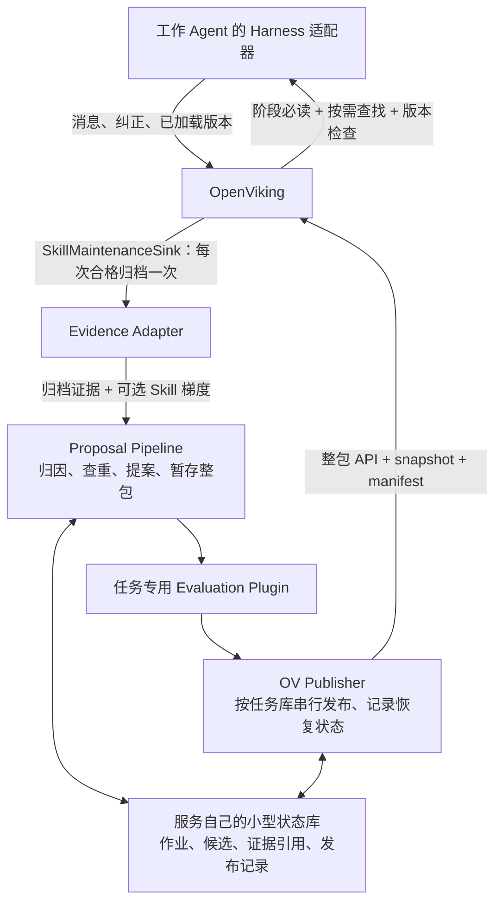

# OpenSpace 对 OV Skill Evolution 的设计借鉴评估

> **第一版方案（2026-10-10）**：采用 [`main` 上的 Skill evolution detour](ov-skill-evolution-detour.md)。本文保留 OpenSpace 机制的取舍分析；接入点以 detour 文档为准。[`feat/train_opt` 分支复核](train-opt-skill-evolution-review.md)只用于说明 Experience 能力边界。

本文承接[多 Agent Skill 库的进化、管理与共享](multi-agent-skill-evolution.md)。评估对象是本地 OpenSpace 提交 `38277815ed44a53d757973c2bc4454c3b6426698` 与 OV 提交 `144033826`。依据为实现代码、相关测试及两个去重函数探针；没有运行完整的模型驱动进化任务，也不推断未提供的云端实现。

## 第一版决策

**有必要吸收 OpenSpace 的部分设计。收益最大的是维护流程的组织方式，尤其是带证据的改动提案、暂存后验证、可恢复的提交，以及按版本记录效果。** 这些正好对应原文档的关键缺口，而且可以放在 OV 外围实现。

保留 OV 作为 Skill 包、引用文件、会话及快照的存储系统，在 `main` 的 Session Skill 候选进入内部 trainer 前新增一个窄的 `SkillMaintenanceSink`，并实现独立的 `skill-evolution-service`。外部服务借鉴 OpenSpace 的数据契约和分阶段流程，通过 OV 公共 API 读写正式包；一个 Agent Harness 适配器负责采集实际加载版本和决策边界刷新。完整引入 OpenSpace runtime 会带来另一套 Skill registry、SQLite 存储、工具运行时和身份映射，接入成本与本场景收益不匹配。

**语义去重和运行中同步仍需自行设计。** OpenSpace 的本地去重主要是候选键合并与名称/描述相似检查，发布后刷新的是本地 registry。它们不足以完成原文档要求的跨 Agent 语义去重、任务库原子发布和版本采用确认。

## 按必要性、能力差距和工程量取舍

“工程量”指按本场景精简重写、通过窄的候选出口及公共 API 接 OV 的相对成本，不是复制原模块所需时间。低：少量契约与规则；中：独立组件及持久化/异常处理；高：涉及运行时改造、真实任务回放或多机一致性。

| OpenSpace 设计 | 在本场景的必要性 | 相对当前 OV 的增益 | 外围接入工程量 | 建议 |
| --- | --- | --- | --- | --- |
| `EvidencePacket`：证据引用、来源、任务范围、固定采集水位 | 高：需判断漏读、未遵守、规则缺失 | 高：OV 有 Session/trajectory，缺本场景统一的“证据 → Skill 变更”契约 | 中，需对接 Harness 和 OV 归档 | **优先吸收精简版** |
| `DecisionRationale` + `Admission`：先提出有依据的变更，再判定是否值得写库 | 高：避免每次失败都生成 Skill | 高：已有 OV 提取/patch 流程可参考，但共享库入口的可审计判断不足 | 低至中 | **优先吸收**，加入漏读/执行偏离分类 |
| `StagedSkillEdit`：在暂存目录修改整包、生成 diff、通过检查后提交 | 高：用户的 references 与正文必须一起维护 | 高：OV 整包更新已具备，候选暂存和发布前业务验证需补 | 中 | **优先吸收**；发布使用 OV API |
| 持久 TriggerJob、幂等 decision、提交日志与故障恢复 | 高：多 Agent 和重试会重复触发写入 | 中至高：OV 有异步任务和锁，缺跨调用的 Skill 提案事务 | 中 | **吸收最小状态机**；无需复制完整调度系统 |
| `intent_spec`：正/负触发条件、泛化边界、成功标准 | 高：提高新 Skill 的可用性并改善漏读 | 高：OV 可以存这些内容，但不提供这一完整创作约束 | 低 | **优先吸收**，作为提案的必备字段 |
| 行为验证：契约检查、召回测试、基线与候选回放 | 验证必要；全量回放不一定首期需要 | 高：OV `validate_skill` 主要校验结构，内部训练也不等于共享库发布验证接口 | 简单任务用例中；通用回放高 | **先接业务验收插件**，按需扩展回放 |
| `provisional/trusted` 与版本 lineage | lineage 高；自动信任晋升中 | 中：OV 有哈希 revision 和快照，但缺改动因果、效果归属 | 低至中 | **先记录 lineage 与效果**，后做自动晋升 |
| `EvolutionCandidateStore` 合并候选 | 合并候选高 | 部分增益；当前 merge key 不等于语义去重 | 借鉴表结构低；真正语义合并中 | **借状态和证据累积思想，不照搬去重算法** |
| 路径触发 Skill、分层发现与加载 | 高，但取决于任务类型 | 部分增益：对文件型任务有用；OV 已有摘要和按需读取 | 一个 Harness 中；跨多个 Harness 高 | **按需借鉴**，核心仍用任务阶段必读规则 |
| 云端分类树、完整排名/质量信号系统、平台 UI、工具 runtime | 当前较低 | 许多部分与 OV 或现有工作 Agent 重叠 | 高 | **首期不引入** |

## 值得吸收的具体机制

### 证据包与改动判断

OpenSpace 的 [`ResourceRef` / `EvidencePacket`](https://github.com/HKUDS/OpenSpace/blob/38277815ed44a53d757973c2bc4454c3b6426698/openspace/skill_engine/evidence/types.py) 将证据分成直接事实、补充材料与派生结果，并保留 task/session/agent、内容哈希和回溯引用。[`PacketBuilder`](https://github.com/HKUDS/OpenSpace/blob/38277815ed44a53d757973c2bc4454c3b6426698/openspace/skill_engine/evidence/packet_builder.py) 从固定证据水位构造分析、修改、验证三个阶段的输入，后续阶段可以追溯前一阶段的决策。

我们只需保留少量关键字段：执行记录 URI、人工纠正原文、实际加载的 Skill URI/revision、相关工具结果、变更理由和验证结果。原始内容继续保存在 OV；外围服务存引用及作业状态，避免维护第二份完整会话库。人工纠正要在采集时明确标记，不能仅希望总结模型从长对话中识别出来。

[`DecisionEngine`](https://github.com/HKUDS/OpenSpace/blob/38277815ed44a53d757973c2bc4454c3b6426698/openspace/skill_engine/decision/engine.py) 检查决策中引用的证据是否存在；[`EvolutionAdmission`](https://github.com/HKUDS/OpenSpace/blob/38277815ed44a53d757973c2bc4454c3b6426698/openspace/skill_engine/evolution/admission.py) 会区分可行动的 Skill 问题与外部环境失败。[分析提示](https://github.com/HKUDS/OpenSpace/blob/38277815ed44a53d757973c2bc4454c3b6426698/openspace/prompts/skill_engine_prompts.py) 区分 Skill 被选中、被实际采用、技能引导阶段失败后由兜底流程成功等情况。这对我们防止错误归因很有价值，但“是否真正遵守”的部分仍是模型判断，应保留不确定状态。

建议我们的分析输出先回答原因，再决定操作：

| 诊断 | 后续动作 |
| --- | --- |
| 已有 Skill 足够，但没有被加载 | 改检索/阶段触发规则；通常无需新建 Skill |
| Skill 已加载，Agent 执行偏离 | 加明确检查或改善指令；不能直接认定原 Skill 错误 |
| Skill 步骤确有缺失、错误或过时 | 修订现有包，并保留失败证据 |
| 新流程已执行且效果得到验证 | 判断补充旧包还是建立新包 |
| 外部工具/网络/权限故障 | 只有发现可复用的处理流程时才考虑改包 |
| 用户明确提出持久规则 | 作为规范性要求处理，同时检查任务范围与现有规则冲突 |

最后一类尤其不能机械套用 OpenSpace 的 CAPTURED 规则。它要求执行证据和独立验证，适合“我发现这个方法有效”；用户规定“以后必须保留来源链接”则是规则来源，不需要先证明一次执行成功才承认这项要求。

### 有边界的总结与整包暂存

OpenSpace 的 [`CaptureContract`](https://github.com/HKUDS/OpenSpace/blob/38277815ed44a53d757973c2bc4454c3b6426698/openspace/skill_engine/capture_contract.py) 将新能力绑定到前提、执行证据、独立验证证据和限制，禁止仅凭任务成功或命令退出码就宣称某个方法正确。[`AuthoringIntentSpec`](https://github.com/HKUDS/OpenSpace/blob/38277815ed44a53d757973c2bc4454c3b6426698/openspace/skill_engine/evolution/authoring_contract.py) 进一步要求触发条件、不适用条件和成功标准。这样总结出的 Skill 可以被检索、测试和判断是否重复。

它用 FIX、DERIVED、CAPTURED 表达修订、派生和新建。我们可以保留来源关系，但应优先更新原包，只有确实出现不同适用范围时才派生。多 Agent 若不断生成 `xxx-enhanced`，反而会增加检索歧义。我们还需显式补 `NO_CHANGE`、`ROUTING_CHANGE`、`MERGE`、`DEPRECATE` 等操作；OpenSpace 的三类作者操作不覆盖完整库治理。

[`StagedSkillEdit`](https://github.com/HKUDS/OpenSpace/blob/38277815ed44a53d757973c2bc4454c3b6426698/openspace/skill_engine/evolution/authoring.py) 记录目录、目标、父版本、修改文件、diff、创作契约和评估计划；[`stage_fix_skill`](https://github.com/HKUDS/OpenSpace/blob/38277815ed44a53d757973c2bc4454c3b6426698/openspace/skill_engine/patch.py) 复制现有包后再编辑，适合保留人工 references。采用这套思想时，下载 OV 包及清单到工作目录，修改后上传**完整包**，不要只发送新的 `SKILL.md`。

不能照搬它的全部快照逻辑：`collect_skill_snapshot()` 明确只保存文本，跳过二进制。我们的附件完整性仍应使用 OV 的全文件清单、SHA-256 和 snapshot；图片、PDF 等引用文件不能因演化而丢失。

### 验证与可恢复提交

[`EvolutionEngine`](https://github.com/HKUDS/OpenSpace/blob/38277815ed44a53d757973c2bc4454c3b6426698/openspace/skill_engine/evolution/engine.py) 已把 packet builder、decision、admission、authoring、validator、behavior evaluator、committer 设计成可注入协作者。这是最适合借鉴的插件边界。现有实现的默认 committer 会改本地目录、写 SkillStore 并刷新 registry，我们应提供自己的 `OVPublisher`，把最终提交改为 OV 公共 API 调用。

[`TriggerStore`](https://github.com/HKUDS/OpenSpace/blob/38277815ed44a53d757973c2bc4454c3b6426698/openspace/skill_engine/triggers/store.py) 提供持久作业、领取、重试及过期恢复；同一 decision 已有成功 action 时，engine 会复用结果，避免重新生成。相关[幂等测试](https://github.com/HKUDS/OpenSpace/blob/38277815ed44a53d757973c2bc4454c3b6426698/tests/skill_engine/test_evolution_retry_idempotency.py)覆盖了重建证据包、建议排序变化和已提交 action 复用。需注意 TriggerStore 可以为已结束的键创建新一轮作业，不能把它理解成“相同业务事件永远只执行一次”。我们的事件、提案、发布分别需要稳定 ID。

[`SkillBehaviorEvaluator`](https://github.com/HKUDS/OpenSpace/blob/38277815ed44a53d757973c2bc4454c3b6426698/openspace/skill_engine/evolution/behavior_eval.py) 分开检查创作契约、正负查询的召回效果、执行回放；默认要求回放，通过配置也可降低无回放条件的要求。因此是否有效取决于接入的 runner、用例和判断标准。我们先提供任务专用的 `evaluate(baseline, candidate, cases)` 插件：人工纠正对应的检查、原失败用例及一组不能退化的正常用例。通用沙箱回放框架可以后置。

## 哪些能力不能直接从 OpenSpace 获得

### 语义去重没有现成解决

当前实现里至少要区分三件事：

1. **重放去重**：同一事件/decision 重试不重复提交。这部分值得借鉴。
2. **候选合并**：[`_merge_key()`](https://github.com/HKUDS/OpenSpace/blob/38277815ed44a53d757973c2bc4454c3b6426698/openspace/skill_engine/evolution/candidates.py) 包含 action、目标、标签、证据类型数量等；所谓 `semantic_identity` 实际由规范化 `reason_summary` 和分类路径的哈希生成。意思相同但表述不同的摘要通常不会命中同一键。
3. **新包重复检查**：[`_is_duplicate_skill()`](https://github.com/HKUDS/OpenSpace/blob/38277815ed44a53d757973c2bc4454c3b6426698/openspace/skill_engine/evolution/validator.py) 比较名称、描述、标签，主要用 `difflib.SequenceMatcher`；不比较完整操作语义。它只检查 CAPTURED/DERIVED，并跳过目标及父 Skill。CAPTURED 的[语义 reviewer](https://github.com/HKUDS/OpenSpace/blob/38277815ed44a53d757973c2bc4454c3b6426698/openspace/skill_engine/evolution/capture_semantic.py)审核证据支持度与泛化边界，类说明明确不做历史匹配。

用实际 `_is_duplicate_skill()` 函数做了两个隔离探针：含义相同但名称/描述不同的 HTTP 限流退避流程未被判重；中文描述的相似度为 0，因为 `_normalized_text()` 仅保留 `a-z0-9`。这说明不能把它直接作为中文、多 Agent 的语义去重器；两个探针不是完整准确率评测。

我们的去重插件仍应执行：任务库限定 → 精确哈希 → OV `skills/find` 相似召回 → 完整正文/相关 reference 比较 → 输出相同、补充、冲突或独立 → 发布前按最新库复查。未发布的候选也要参与查重；它们应保存在独立候选区，不能为了可检索而提前混入正式 Skill 根。语义查找只提供候选，最终判断需保存比较理由，避免错误合并不同前提下的流程。

### 候选队列不是现成的自动晋升队列

OpenSpace 的 [`EvolutionCandidateStore`](https://github.com/HKUDS/OpenSpace/blob/38277815ed44a53d757973c2bc4454c3b6426698/openspace/skill_engine/evolution/candidates.py) 累积来源任务、证据与出现次数，但当前候选主要用于审计。[测试](https://github.com/HKUDS/OpenSpace/blob/38277815ed44a53d757973c2bc4454c3b6426698/tests/skill_engine/test_skill_trust_lifecycle.py)明确断言 `CANDIDATE_RECHECK` 不再支持、review item 为 `inspect`、没有 approval 操作，也不自动晋升。我们可以借它的记录结构；补充证据后重新处理提案的工作流仍需实现。

### 本地刷新不等于运行中多 Agent 同步

[`EvolutionCommitter._refresh_registry()`](https://github.com/HKUDS/OpenSpace/blob/38277815ed44a53d757973c2bc4454c3b6426698/openspace/skill_engine/evolution/engine.py) 只更新持有的本地 registry。[动态路径触发](https://github.com/HKUDS/OpenSpace/blob/38277815ed44a53d757973c2bc4454c3b6426698/openspace/skill_engine/protocol.py)能在访问文件时发现相关 Skill，但不能替代任务阶段必读检查。

云端客户端有包 snapshot、内容哈希和本地 `clean/dirty/conflict` [映射状态](https://github.com/HKUDS/OpenSpace/blob/38277815ed44a53d757973c2bc4454c3b6426698/openspace/cloud/local_mapping.py)，可借鉴缓存失效思想；本次读取的代码不能证明它保证所有远程 Agent 已采用新版本。我们仍需原设计的 `library_revision`、按阶段刷新、采用回执及旧版本处理。OpenSpace 的证据 `manifest_watermark` 是证据采集水位，云端分类树的 `snapshot_version` 也不是我们的任务 Skill 库发布版本，三者不可混用。

### OpenSpace 的实际 Skill 加载路径

启动时，[registry 构建器](https://github.com/HKUDS/OpenSpace/blob/38277815ed44a53d757973c2bc4454c3b6426698/openspace/runtime/skill_registry.py)扫描配置目录、项目目录、用户目录和内置目录中的 `SKILL.md`；[SkillRegistry](https://github.com/HKUDS/OpenSpace/blob/38277815ed44a53d757973c2bc4454c3b6426698/openspace/skill_engine/registry.py)解析 frontmatter 并建立本地索引，正文按需加载。每轮开始时，[SkillListingService](https://github.com/HKUDS/OpenSpace/blob/38277815ed44a53d757973c2bc4454c3b6426698/openspace/skill_engine/protocol.py)把可见 Skill 的名称和简介压入预算受限的 `skill_listing`；初始预算默认约占上下文窗口的 1%，超大库只优先展示部分条目。任务开始的 `turn0_prefetch`、工具返回后的 `post_tool_prefetch` 会自动做候选发现；触及匹配路径时还会发送 `dynamic_skill` 提示。这些消息由[附件格式器](https://github.com/HKUDS/OpenSpace/blob/38277815ed44a53d757973c2bc4454c3b6426698/openspace/services/conversation/attachments.py)包装为 `role=user` 的 `<system-reminder>`，候选里没有完整正文。

发现器先尝试名称精确/前缀匹配，再用关键词检索，必要时用 BM25 + embedding 排序，并可在置信度不足时交给 LLM 选择。Agent 也可主动调用 `DiscoverSkills`。默认的正文加载入口是 Agent 调用 `Skill(name)`；它读取完整 `SKILL.md`，作为 `invoked_skill_content` 附件加入当前会话。默认 inline 执行；`context: fork` 在子上下文执行。正文携带 Skill 目录路径并替换目录变量，但 **references/scripts/assets 不会随着 `SKILL.md` 自动全部展开进上下文**，Agent 需依据正文按需读取。某个 Skill 被列出或被发现，并不证明 Agent 已实际调用并遵守它。

## 推荐的可插拔接入结构

建议只建立以下接口边界；这些是新服务的设计接口，不是已有 OV API：

| 接口 | 输入/输出 | 使用的 OV 能力 |
| --- | --- | --- |
| `SkillMaintenanceSink.submit(event)` / `EvidenceSource.collect(run_id)` | OV 归档事件与可选 Skill 梯度、纠正、loaded revisions、结果 → EvidenceBundle 与排队回执 | sink 是拟新增的 OV 出口；Session archives、tool-results 已有，Harness 显式补 Skill 加载记录 |
| `ProposalPolicy.propose(bundle, catalog)` | 原因分类、目标包、证据、范围、操作 → Proposal | 列出/读取 Skill；需要时 `skills/find` |
| `Deduplicator.resolve(proposal, latest_library)` | 与已发布包及待处理候选比较 → 更新/合并/新建/无需改动 | OV 语义召回、正文和附件读取；候选区自行索引/比较 |
| `AuthoringBackend.stage(proposal, packages)` | 可审查的完整候选包及 diff | 下载 OV 包；模型编辑本地暂存目录。Compile 可选，但必须输出到隔离的候选位置 |
| `Evaluator.evaluate(baseline, candidate, cases)` | 格式、引用、触发和任务效果 → 可发布判定 | `skills/validate` 只做基础结构检查，其余由插件实现 |
| `Publisher.publish(proposal_id, expected_revisions, bundle)` | 一次 release 变更一个包；输出发布结果、新包 revision、library_revision、快照和动作状态 | Skill 增改删、等待任务、完整性读取、snapshot、content/write |
| `HarnessAdapter.refresh(boundary)` | 拉取清单、加载必读内容、记录采用版本 | content/read、get_skill、find_skills、附件下载 |

`expected_revisions` 是我们发布器的参数，**OV 当前整包更新接口并不接受它**。单写入服务应在持有任务库写锁时复查包 revision，并把所有发布操作纳入同一入口；若允许其他进程直接改这些包，仅靠“先读再写”仍有竞争窗口。

服务状态库可以先用 SQLite，只部署一个发布者；OV 继续保存正式包和原始证据。不直接 import `openviking/session/train` 或 OpenSpace 的本地 SkillStore。需要多个服务实例时再升级作业租约/存储并发协议，这样不会把第一版变成两个存储系统间的全面同步项目。

身份字段需要从第一版区分清楚：

- `library_id`：共同服务某类任务的 Skill 库，如论文审核。
- `run_id`：某次具体任务执行；同一任务的多个 Agent 另有 `agent_id`。
- `logical_skill_id`：跨修订保持稳定的业务身份；内容版本用 OV `root_uri + revision` 绑定。
- `proposal_id` / `release_id`：提案幂等与发布恢复的身份。

OpenSpace 的候选出现次数按不同 task ID 累积。接入时若把所有工作 Agent 的业务任务类型都当作同一个 task ID，独立验证次数会失真；同一次执行的多个 Agent 也不应自动算成多个独立成功样本。

## 工程范围与优先级

| 次序 | 建设范围 | OV 核心改动 | 主要成本和验收 |
| --- | --- | --- | --- |
| 1 | OV 候选出口、一个 Harness 的证据采集、简化 EvidenceBundle、带原因的 Proposal | 必需：detour 模式、`SkillMaintenanceSink`、无 Case 也提交证据、提案回执与正式包 URI 分离 | 成本中；用“没读/没遵守/规则缺失/新问题/人工规则”样例检查归因 |
| 2 | 中央语义去重、整包暂存、任务验证、串行发布、幂等恢复 | 无额外核心改动，前提是正式库只有一个发布入口 | 成本中；并发同义提案不重复建包，正文与附件完整，失败重试不二次发布 |
| 3 | 清单版本、阶段刷新、采用回执 | 无额外核心改动；主要改 Harness | 单一可控 Harness 成本中；下一决策边界可验证采用了哪个版本 |
| 4 | 按版本效果记录、自动降级/晋升、丰富回放用例 | 可选 | 成本中至高；留作后续阶段 |

前三步共同构成第一版，不能只交付证据适配或 Experience 补充。原先“OV 核心可零改动”的估计已不适用于选定的 detour，因此不沿用原先的 2–4 人周粗估；工程量需要按 OV 候选出口、Harness、worker、任务验收和发布恢复分别拆单。

第一版采用“串行原地更新 + 版本不匹配时暂停加载并重试”，在决策边界核对清单与实包 revision。若包写入成功但清单推进失败，由发布日志恢复，不把半完成发布标为成功。若必须保证旧任务持续读取旧版、并且一组包完全同步切换，则需不可变发布包或按快照读取的适配器，最后原子切换清单指针；这会额外增加版本存储、名称/路径映射和清理成本，不能只靠通知解决。

第一版需要的 OV 核心小改动就是候选出口：把提取与内部写入解耦、每次合格归档送一次证据，并提供可靠的提案回执。允许多个直接写入者时，为整包 `PUT` 加 `expected_revision` 条件检查；需要消除同名根回退风险时，为管理 API 加严格目标选择，属于后续可选增强。内部 Skill trainer 的 loader/search 缺口仅在将来改回 direct 写入路径时才成为前置修复。

## 首期明确不吸收的部分

- 完整 OpenSpace 应用、工具执行 runtime、cloud/UI 和本地 SkillStore：会形成额外存储与运行时耦合。
- 把名称/描述字符串相似度当作语义去重：可保留为廉价的第一道检查，不能作为最终判据。
- 默认不断派生新 Skill、或直接把所有新版本标为可广泛使用：会增加检索歧义和错误传播。
- 通用质量评分、完整分类树、复杂自动晋升：先积累可归因的使用记录，固定任务库不必一开始建设大规模市场式排名。
- 全面改写 OV 自进化内核：第一版只加入候选出口，包维护、去重和验收仍留在外围。

首个验证闭环应足够具体：人工 Skill 和 reference 入库 → 两个 Agent 对同一问题分别提出候选 → 系统合并为一次旧包修订 → 跑原失败用例 → 发布并记录新 revision → 另一个运行中的 Agent 在下一阶段加载新版。这个闭环同时检验总结、去重、附件维护和同步，也能直接衡量借鉴 OpenSpace 设计后的实际收益。
