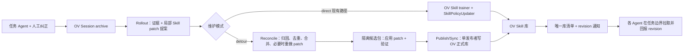

# 在 OpenViking `main` 上接一条 OpenSpace 式 Skill evolution detour

核对基线：`main@144033826` 与本地 OpenSpace。**本文是第一版选定的实现方案**；其中的旁路、worker 和 Harness 协议均为待实现设计，不代表仓库已有 `SkillEvolutionDetour` 接口。

## 结论和切口

**第一版采用可关闭的旁路，并按 Rollout、Reconcile、Publish/Sync 三个模块实施。** 人工 `SKILL.md + references/scripts` 先作为正式包导入 OV。Rollout 模块保留 OV 的 Session 归档与 Skill 候选抽取，在候选进入 `StreamingPolicyTrainer.submit_gradients()` 之前分流证据，再形成带证据的局部 patch 提案；Reconcile 模块集中归因、去重、合并和暂存整包；Publish/Sync 模块是唯一正式写入者，通过 OV 的整包 Skill API 更新共享库并推动 Agent 刷新。Experience 可独立运行，但不作为 Skill 提案或发布的必经步骤。




### 三个模块的契约


| 模块               | 输入 → 输出                                                                                                                                                | 写入权限                        |
| ---------------- | ------------------------------------------------------------------------------------------------------------------------------------------------------ | --------------------------- |
| **Rollout**      | Harness 的任务上下文、OV 轨迹/纠正、已加载 Skill 版本 → `SkillPatchProposal`。它可以附 `CREATE/UPDATE/DEPRECATE/DELETE/ROUTING_CHANGE` 的局部修改建议；无法可靠定位时提交证据和问题描述，`patch` 可为空。 | 只写提案与证据索引，不改正式 Skill。       |
| **Reconcile**    | 多 Agent 提案 + 当前库清单和候选包 → 归因、跨提案去重、冲突消解、必要时重生成 patch、将 patch 应用到隔离完整包、业务验证 → `ValidatedReleaseCandidate`。                                               | 只改隔离候选目录；不能写 OV 正式 Skill 根。 |
| **Publish/Sync** | 通过验证的候选包 + 基线 revision → 持锁复查、整包写入 OV、读回、推进 `lib_version`，发送版本通知；Harness 在决策边界拉取并回报采用版本。                                                          | 唯一允许写正式 Skill 库和库清单的模块。     |


`SkillPatchProposal` 至少固定 `proposal_id`、`library_id/run_id/agent_id`、`base_lib_version`、`archive_uri` 与证据引用、目标 Skill URI（允许暂时未知）、`base_skill_revision`、操作类型、修改理由和适用边界。多文件 patch 的每个文件还记录相对路径、操作（增/改/删）及原文件哈希；文本文件可用结构化 patch，二进制附件用候选 blob 引用。局部 Agent 提议的目标和 patch **不是最终决定**：Reconcile 必须先检查现有 Skill 是否已覆盖、其他 Agent 是否提交了同义提案，再对最新包重定位和应用。若基线版本变化，重新合并或要求重生成，不能把旧 patch 直接覆盖新版。Agent 提案的理由和轨迹是必填；人工直接修订可省略理由，但必须记录操作和实际 diff；人工纠正原文作为反馈证据保存。

OV 内部的 `SkillMaintenanceSink` 先交出 `SessionEvidence`（可附现有 `skill_gradients`），外围 Rollout 适配器再把它和任务上下文、已加载版本及必要的按需文件读取整理成 `SkillPatchProposal`。因此 OV 内核只需窄的证据出口；不要求当前 Skill 抽取 schema 一开始就能生成 references 的多文件 patch。对证据充分却没有可用梯度的 run，Rollout 仍可提出新 patch，或提交无 patch 的问题供 Reconcile 处理。

**OpenSpace 复用边界：** 第一个接口不用从零建模：`ResourceRef/EvidenceEvent/EvidenceScope/EvidencePacket`、`TriggerJob`、`DecisionRationale`、`StagedSkillEdit/AuthoringResult`、`ValidationResult` 和 `SkillBehaviorEvalResult` 已覆盖证据引用、任务与 Agent 标识、作业幂等、决策、暂存和验收结果。第一版可用适配器映射 OV 归档和 Harness 的 `library_id/run_id/loaded_skill_revision`，并让 `SkillPatchProposal` 引用这些记录；`ValidatedReleaseCandidate` 可由暂存结果与两类验证结果组成，不必重写一套同名状态模型。

第二个接口只有部分现成能力：OpenSpace 的 `EvolutionCandidateStore` 能按 merge key 合并待审记录及来源，`stage_fix_skill()` 能隔离复制并应用多文件文本 patch，`EvolutionCommitter` 有本地备份和故障恢复。这些不能直接解决跨 Agent 语义同义提案、两个 patch 的修改冲突、目标包 revision 已变化后的重做，也不能对 OV 正式库做条件发布。Reconcile 需补一个包级协调器：先对当前任务库和待处理提案做语义归因，锁定目标包及基线；仅在基线哈希匹配时应用局部 patch，否则以最新完整包重生成/重验证，无法确定时转待审；最终交给单一 `OVPublisher`。OpenSpace 默认的 FIX/DERIVED/CAPTURED 本地提交器也不覆盖正式库的删除和 Agent 同步。

这与 Git 的分工相近：Rollout 形成局部 diff，Reconcile 负责暂存、rebase/merge 与测试，Publish/Sync 将一个验证过的包版本发布到唯一库，其他 Agent 在安全边界 pull。广播的是“库版本已变化”信号，正文和 references 由各 Agent 从 OV 拉取；共享存储可见不等于 Agent 已采用。

这里的 detour **并不直接复用 OpenSpace 的默认 committer**：它提交的是 OpenSpace 本地 SkillStore 和 registry；我们需要 `OVPublisher`。也不建议仅把 OpenSpace CLI `fix_skill(skill_dir, direction)` 放进 VikingBot 工具列表：该入口针对已知本地目录、手工给定修改方向，会运行并提交其自身本地流程，缺少 OV 轨迹、版本、共享发布和提案隔离的完整协议。[OpenSpace Engine 的可注入协作者](https://github.com/HKUDS/OpenSpace/blob/38277815ed44a53d757973c2bc4454c3b6426698/openspace/skill_engine/evolution/engine.py#L75)、[默认 committer](https://github.com/HKUDS/OpenSpace/blob/38277815ed44a53d757973c2bc4454c3b6426698/openspace/skill_engine/evolution/engine.py#L718)、[现有 MCP fix_skill](https://github.com/HKUDS/OpenSpace/blob/38277815ed44a53d757973c2bc4454c3b6426698/openspace/entrypoints/mcp/server.py#L1639)。

## 为什么选在梯度之后、写入之前

`main` 的 `extract_session_skills()` 已能从消息生成 `skill_gradients`，然后立即调用 Skill trainer。这里适合换成可插拔 sink：[当前提交点](https://github.com/volcengine/OpenViking/blob/144033826eb3d612de1a64b46efa7cb5f6073a41/openviking/session/compressor_v3.py#L819)。写入端的 `SkillPolicyUpdater` 接受的是单文件正文与元数据计划；上游 schema 只有 `skill_name/description/content`。如果只替换 updater，OpenSpace 已经没有足够信息去决定“为何改”和“reference 文件如何改”，还要先修复 OV 的 Skill PolicySet 重载及候选搜索。前移一个节点可以把完整归档、纠正和已加载版本一起交给提案 worker，之后用 OV 整包 API 发布。

同时不能**只**把已有 `skill_gradients` 当作 detour 唯一入口。OV 模板偏向用户长期规则；Agent 解决了一个新问题但模型没有生成梯度时，旁路也应有机会根据归档证据作 `NO_CHANGE/FIX/NEW` 决策。因此 detour 每次接收一个 `SessionEvidence`，Skill 梯度只是其中一类提示，不是唯一触发条件。

## OV 需要的最小改动


| 位置                    | 修改                                                                                                   | 原因                                                                                  |
| --------------------- | ---------------------------------------------------------------------------------------------------- | ----------------------------------------------------------------------------------- |
| 配置                    | 保留现有 `session_skill_extraction_enabled` 总开关，增 `skill_maintenance_mode = direct / detour`，默认 `direct` | 不改变现有部署行为；detour 可回退。                                                               |
| `SessionCompressorV3` | 注入 `SkillMaintenanceSink`；抽出 `propose_session_skills(messages, ctx, archive_uri)`，只运行抽取并返回梯度，不写正式库   | 入口稳定，不把 OpenSpace import 进 OV 内核。                                                   |
| commit 分流             | detour 模式对每个允许 self-memory 的归档提交一次 `SessionEvidence`；不依赖 Case 是否存在，也不再逐 Case 抽 Skill                 | 修复无 Case 跳过和同 Session 多 Case 重复生成。可参考 `feat/dag_exp_mode` 的“一次抽取”调度，但它仍在无 Case 时跳过。 |
| 返回契约                  | `skill_proposal_job_ids` 与实际 `session_skill_uris` 分开；前者表示已接收/排队，后者仅记录真正发布成功的包                        | 避免把“已提案”误报为“已安装”；绕开当前共享批次 Skill URI 归属缺陷。                                           |
| 安全边界                  | detour 模式禁止内部 Skill trainer 同时落盘；配置恢复 direct 时才走旧路径                                                  | 单一正式写入者，避免两个维护器对同一包竞争。                                                              |


概念接口（**拟新增，不是现有 API**）：

```python
class SkillMaintenanceSink(Protocol):
    async def submit(self, event: SessionEvidence) -> ProposalReceipt: ...

@dataclass
class SessionEvidence:
    event_id: str                 # 幂等键：session/archive/batch
    library_id: str               # 共同任务 Skill 库
    archive_uri: str
    run_id: str
    agent_id: str
    session_id: str
    run_context_ref: str          # Harness 预登记的任务元数据快照
    message_ids: list[str]        # 本次归档覆盖的消息；避免重复计入
    skill_hints: list             # OV skill_gradients，可为空
    loaded_skills: list           # 真正读取/启用的 URI + revision
    corrections: list            # 人工纠正及其来源消息 ID
    outcome_refs: list           # 工具结果、验收结果的 OV URI
```

`loaded_skills` 和 `corrections` 需要 Harness 显式记录；仅凭当前梯度或“Skill 出现在可见列表”不能判断 Agent 是否实际加载并遵守。原始消息/文件仍留在 OV，旁路持久化引用、摘要、作业状态即可。

## 第一版的维护原料与读取协议

一次维护判断的原料不是“整段轨迹 + 整个 Skill 库”直接拼进提示，而是以下可回溯的输入：


| 输入          | 取得方式                                                                                                                                        | 用途                                                                          |
| ----------- | ------------------------------------------------------------------------------------------------------------------------------------------- | --------------------------------------------------------------------------- |
| 任务上下文快照     | Harness 在运行前向外围服务登记 `library_id`、`run_id`、`agent_id`、`session_id`、任务目标/阶段、成功标准、预期必读 Skill 和当时的 `lib_version`；`run_context_ref` 指向不可变快照 | 限定哪个任务库、判断规则是否适用；不从轨迹文本猜任务身份。第一版一个 OV Session 对应一次 run，多个 Agent 各有 Session。 |
| 原始执行轨迹      | `archive_uri/messages.jsonl` 的消息 ID、role、parts、时间、turn ID；工具大输出另按 `tool_output_ref` 读取                                                      | 还原用户请求、Agent 操作、工具结果和人工纠正发生顺序。抽取摘要或梯度只作线索，关键事实要回到原始证据。                      |
| 使用与结果记录     | Harness 的 `loaded_skills`（URI + revision + 加载时点）、明确标记的纠正消息 ID、任务结果/验收 URI                                                                   | 区分漏读、已读未遵守、现有规则错误及已验证的新流程。OV 消息中的 `skill_uri` 不能单独证明正文已读或被遵守。               |
| 现有 Skill 状态 | 任务清单、已发布包和待处理提案；先读名称、描述、revision、路径/哈希清单，定位目标后读 `SKILL.md`                                                                                  | 确定是修订旧包、改路由规则、合并候选还是新建包，并固定修订基线。                                            |


OV 当前 Session 的 `Message` 是 `role + parts`，归档为 `messages.jsonl`；`parts` 可含 `text`、`context`、`tool` 和图像引用。`ToolPart` 记录工具名、输入、状态、输出或外置结果引用。现有 Session 创建/commit 请求没有通用的业务 `task_context` 字段，commit 的 `extraction_metadata.event.tags` 只服务事件记忆标签；第一版由 Harness 在外围登记任务上下文，并以 `session_id/run_id` 关联归档，不把这些标签误当任务协议。若一个 Session 承载多个 run，必须改为逐段标记消息范围或为每个 run 单建 Session，第一版采用后者。

### Reference 很多时

**存储和模型上下文分开处理。** 对原包做完整字节级暂存，保证未修改的 references/scripts/assets 原样保留；模型初始只看任务上下文、证据摘要、`SKILL.md` 和文件清单（相对路径、大小、哈希、类型），不展开所有 reference。维护 worker 根据 `SKILL.md` 引用、出错工具调用、文件名/关键词搜索和待改操作，调用受限 `list_files/search_files/read_file` 工具按需读取相关文件片段；每次读取有文件大小、片段和总 token 预算。二进制文件先提供元数据或可用的提取结果，不能无声忽略。候选包生成后对**全部**文件做哈希/路径完整性检查，并对改动文件和引用关系做验证；超出可审查预算或缺关键证据时保持待审，不自动发布。

### 是否有 Agent loop

有两层需要区分。OV 现有 Session Skill 提取使用受限 `ExtractLoop`，可列出已有 Skill、按需 `read` `SKILL.md` 并生成梯度；它不负责完整 reference 阅读、整包编辑或正式发布。第一版外围 worker 的维护 agent loop 采用 OpenSpace `EvolutionEngine` 的分阶段协作者与 `SkillEvolver` 的工具调用、结构化完成和失败反馈修订模式：读取证据/候选包 → 归因与去重 → 按需读取 reference → 在隔离目录输出多文件修改 → 验证和任务回放 → 有界修订或转待审。模型调用由适配器接入宿主 VikingBot 已配置的 LLM endpoint、模型与认证参数，不另建一套 OpenSpace 模型配置；只读证据/文件工具和候选目录的确定性文件操作仍由 detour 限定。OpenSpace 原有文本 patch 执行器需增加跨文件文本片段复制、二进制附件的字节清单及原文件哈希校验；应用前核对提案的基线文件哈希，发布前核对 OV 当前整包 revision，版本变化时重新规划和验证。正式发布由 `OVPublisher` 完成。维护循环与工作 Agent 的任务执行循环分离；模型不能直接写共享正式库。

**维护 loop 的工程取舍：**直接复用 VikingBot 可省去模型 endpoint、认证、通用工具调度和基本 agent loop 的搭建，适合先做一条单包原型。但它的工作 Agent loop 没有现成的证据包、隔离暂存、结构化 `AuthoringResult`、逐次验证失败后的有界重试和禁止写正式库的边界；这些都要在 Bot 外再补。OpenSpace 的 `SkillEvolver`/authoring backend 已围绕多文件修订组织工具循环和暂存结果，更贴近 Reconcile 的主体。第一版因此复用 OpenSpace 的维护 loop 设计，做薄的 VikingBot 模型配置适配器与 OV 证据/包工具适配器，不引入其完整应用 runtime 或本地 committer。此判断是按所需能力的改造面比较，具体工时仍需原型验证。

### 同一版本中的多个修改

每条提案记录 `base_lib_version`、目标包 revision、目标文件原哈希、文本锚点、`intent_spec` 和到达序号；`proposal_id` 是候选身份，不是正式库 revision。第一版主要处理**内容错位或锚点失配**。两个未发布提案 A、B 基于同一 `lib_version` 时，分别从同一基线暂存 `base+A`、`base+B`，检查触及文件、锚点与依赖。仅在改动独立、锚点仍匹配时，才按稳定的到达序号应用到一个候选包，并验证组合后两条意图；相同 `lib_version` 本身不足以保证顺序应用安全。可以比较 `A→B` 与 `B→A` 的局部结果来发现干扰，但结果不同只触发复核，不自动判定目标互斥。

若第二条 patch 因前一条修改而找不到原位置，或 reference 被移动/改名，维护 loop 从原始意图和轨迹证据在最新候选包上重新定位并合成最终包 `T`，而不是反复尝试旧 patch。若 A 已发布成新 `lib_version`，迟到的 B 先查是否已被 A 覆盖，再检查 B 的目标文件哈希与锚点：库版本虽变但目标文件未变时可直接暂存验证；目标内容失配时由维护 loop 基于新正式库融合并重新验证。只有自动重定位和模型合成都无法可信解决时转待审。

每个输入 atom 都要有明确结论：已由当前包覆盖、被同义提案吸收、已在 `T` 中实现、与其他目标冲突而待审，或因证据/验证不足被拒绝。验证既检查每个已采纳 atom 的预期行为，也检查合成后的整包行为、文件引用和附件哈希；不能因后执行的操作使先前意图失效而仍声明全部成功。若两个目标本身不可兼得，不能靠调整 patch 顺序解决，必须根据证据做有记录的取舍，无法判定时不发布该冲突组。若合成后正式库 revision 又变化，以新基线重新规划并重验。

跨包联动也可先作为一个 `ChangeGroup` 联合暂存和验证，但第一版仍逐包发布。只有存在保持过渡状态可用的发布顺序时才自动推进；必须同时切换多个包才能成立的修改保持待审，直到具备不可变包版本与原子清单切换。

上述协议只保证首期单包 release；语义上互相排斥的目标，以及必须原子切换多个包的提案，均转待审。发布器一次只推进一个 `lib_version`，并在最终写入前复核包 revision；工作 Agent 尚未采用新版本时产生的提案允许带旧 `base_lib_version` 入队，但不能因此直接写回旧包。

## Detour worker 做哪些事

1. **归因与准入**：参考 OpenSpace `EvidencePacket`、`DecisionEngine`、`EvolutionAdmission`。将漏读、已读未遵守、原规则错误、已验证的新流程、外部故障、用户长期规则分开；可输出 `NO_CHANGE` 或 `ROUTING_CHANGE`，不必每次改包。
2. **两层去重**：先按 `event_id/proposal_id` 幂等，合并同一时间待处理提案；再对 OV 已发布包和候选包做任务范围、触发条件、前提、步骤、验收条件的语义对比。OpenSpace 的名称/描述相似度只作廉价初筛，不能决定跨 Agent 同义合并。
3. **整包暂存**：从 OV `GET /api/v1/skills/{name}?include_integrity=true` 获取 revision、文件路径和哈希，再下载 `SKILL.md` 及全部 references/scripts/assets，复制到隔离候选目录。借鉴 `StagedSkillEdit`、`stage_fix_skill()` 的 before/proposed/diff，但扩展到二进制附件：OpenSpace 自带的文本 snapshot 会跳过二进制。[OpenSpace 暂存](https://github.com/HKUDS/OpenSpace/blob/38277815ed44a53d757973c2bc4454c3b6426698/openspace/skill_engine/patch.py#L207)、[文本快照限制](https://github.com/HKUDS/OpenSpace/blob/38277815ed44a53d757973c2bc4454c3b6426698/openspace/skill_engine/patch.py#L1065)、[OV 完整性清单](https://github.com/volcengine/OpenViking/blob/144033826eb3d612de1a64b46efa7cb5f6073a41/openviking/server/routers/skills.py#L355)。
4. **验证**：先检查 Skill 格式、相对引用、附件完整性和 `intent_spec` 中的正/负触发；再用原失败用例和正常用例比较基线包与候选包。OpenSpace `SkillBehaviorEvaluator` 有接口分层，但实际回放效果依赖我们自己的任务 runner。[行为验证器](https://github.com/HKUDS/OpenSpace/blob/38277815ed44a53d757973c2bc4454c3b6426698/openspace/skill_engine/evolution/behavior_eval.py#L232)。
5. **串行发布**：单发布者在写锁内重新读取 OV 包 revision、确认未被更改，然后上传整个候选包，通过 `POST /api/v1/skills` 新建或 `PUT /api/v1/skills/{name}` 替换，显式指定 `target_uri=viking://agent/skills`，等待处理，再读完整性清单核对新 revision。删除单独走 `DELETE`，首期只处理明确授权的删除。OV PUT 有包备份与失败恢复，但 API 当前没有 `expected_revision` 条件参数；若允许旁路之外的写入者，应给 PUT/DELETE 增加局部 CAS。[新增接口](https://github.com/volcengine/OpenViking/blob/144033826eb3d612de1a64b46efa7cb5f6073a41/openviking/server/routers/resources.py#L364)、[整包替换](https://github.com/volcengine/OpenViking/blob/144033826eb3d612de1a64b46efa7cb5f6073a41/openviking/server/routers/skills.py#L747)、[删除接口](https://github.com/volcengine/OpenViking/blob/144033826eb3d612de1a64b46efa7cb5f6073a41/openviking/server/routers/skills.py#L1034)。
6. **通知与采用**：发布者推进 `lib_version` 并发出事件；拟在 OV 响应附带小于 1000 token 的新版本、受影响包及短摘要，前提是调用方上报自己的已采用版本。仅再次调用 OV 的 Agent 能收到这个通知。Agent Harness 在下一任务/工具决策边界核对清单，替换活动上下文中的旧 `SKILL.md`，按需重读 references，并按 `agent_id/run_id` 记录实际采用的库/包 revision。首期四份 `SKILL.md` 可在 token 预算内直接加载。发布者维护目标 Agent 的采用回执或任务结束状态；只有收到目标 Agent 的回执，才能声明这些 Agent 已采用。OV 响应通知和 Harness 刷新/回执都是拟新增协议；VikingBot 的 post-call hook 位于 Bot 层，不能直接充当服务端广播。

第一版限制一个 release 只改一个包，单发布者用“持锁复查 + OV PUT + 读回 + 推进清单”建立成功语义。若包已替换但清单更新失败，发布日志保留待恢复状态；消费者发现清单 revision 与实包不符时暂停加载该包并重试，不把半完成发布当成已采用。作业状态依次记录 `received → classified → staged → validated → published`；随后分别记录各目标 Agent 的 `adopted` 回执或 `run_ended`。`NO_CHANGE`、验证失败和待重试是单独的终止/暂停结果。`received` 只表示提案已入队，`published` 必须以 OV 写入、读回和库清单推进为准，`adopted` 必须有该 Agent 的 Harness 版本回执。若必须一次原子切换多个包，还需不可变包版本和原子切换的库清单指针；OV 现有逐包 API 不提供多包事务。

## 与“仅替换 SkillPolicyUpdater”的区别

直接做 `StagedSkillPolicyUpdater` 也可行：让 `PatchMergePolicyOptimizer` 产出计划后暂存、验证、再发布。它最贴近现有类结构，适合**只改** `SKILL.md` **正文**的受控实验。要满足人工包 + references + 多 Agent 去重，至少还需扩展计划数据结构、修复 `PolicySet.reload()` 固定 Experience loader、核实 Skill 语义候选搜索、解决 Skill 提交结果归属，以及补 no-case 触发。因此其真实工程量未必更小。见[重载调用](https://github.com/volcengine/OpenViking/blob/144033826eb3d612de1a64b46efa7cb5f6073a41/openviking/session/train/engine.py#L80)、[错误的固定 loader](https://github.com/volcengine/OpenViking/blob/144033826eb3d612de1a64b46efa7cb5f6073a41/openviking/session/train/domain.py#L90)、[SkillPolicyUpdater 输入](https://github.com/volcengine/OpenViking/blob/144033826eb3d612de1a64b46efa7cb5f6073a41/openviking/session/train/components/skill_policy_updater.py#L235)。

第一版的完成条件是以下闭环：两名 Agent 在同类任务中遇到同一问题；只形成一个修订提案；保留原 references 并增加必要的新 reference；通过失败与正常用例；发布到共享根；第三名运行中 Agent 在下一个决策边界加载新版并回报 revision。新建包与明确授权的删除也使用同一提案、验证、单发布者协议。完整 OpenSpace runtime、多包原子事务、自动信任晋升和多个 Harness 的统一适配不在第一版范围；完成闭环后再决定是否把外围能力内收进 OV trainer。
