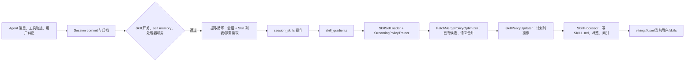

# OpenViking Session Skill 维护链路：`main` 与 `feat/train_opt`

核对日期：2026-10-10。以下依据当前远端分支指针与代码静态检查；尚未做真实 VLM、存储和多 Agent 并发的端到端运行验证。

> **第一版接入决策**：以 `main` 为基线，采用[可关闭的 Skill evolution detour](ov-skill-evolution-detour.md)。本文描述现有分支能力与缺口；第一版复用归档和候选提取，将证据送到外围包维护 worker，不启用内部 Skill trainer 写共享正式库。

## 1. 版本结论

| 分支 | 核对时提交 | 与 Skill 维护的关系 |
| --- | --- | --- |
| `origin/feat/train_opt` | `0989989fe`，2026-09-20 | Experience/Case 训练实验更丰富，但保留了较早的 Session Skill 合并和写入实现。 |
| `origin/feat/train_opt_dt` | `6aab1c8aa`，2026-10-09 | 分支头时间更晚，但所检查的 Session Skill writer、updater、schema 与 `feat/train_opt` 没有差异；不能据分支头日期认定 Skill 更新。 |
| `origin/feat/dag_exp_mode` | `f7dd3c131`，2026-09-27 | 包含 `main` 的 9 月 22 日 Skill writer 修复；9 月 26 日 `5d1c77e89` 将 Skill 抽取改成每个 Session 独立执行一次，不再随每个 Case 的 trajectory 分析重复抽取，同时调整抽取协议提示。它仍是实验分支。 |
| `origin/main` | `144033826`，2026-10-09 | 当前核对范围内最新的已合入 Session Skill 维护代码。2026-09-22 的 `03f596b72`（[#5249](https://github.com/volcengine/OpenViking/pull/5249)）修复创建/修改的写入路径。 |

全仓相关路径提交历史中，`5d1c77e89` 是时间上较晚的 **Skill 抽取调度**改动；它没有新增包级维护、去重或共享发布实现。因此本文以 **`main` 的最新已合入 Session Skill writer/维护链路为基线**，另列 `feat/dag_exp_mode` 的较新实验性抽取方式；把 `feat/train_opt` 的 Experience 训练增强视为另一组尚未整体合入的能力。分支有分叉，不能把各线特性直接相加当成某个现成版本。

## 2. `main` 的完整数据流

### 2.1 触发与分流

`memory.extraction_enabled` 默认开启，`memory.session_skill_extraction_enabled` **默认关闭**。Session commit 归档消息后才执行长期记忆抽取。当前用户的 `MemoryPolicy.self_enabled` 必须允许自记忆，且需要消息、RequestContext 和 SkillProcessor。自动 commit 自身也有独立配置，默认关闭；这里并不意味着只能自动 commit，显式 commit 也能触发。

分流有两个：

1. Agent Evolution 关闭时，满足上述条件会调用 `extract_session_skills()`，仅抽 Skill，不写 trajectory/experience。
2. Agent Evolution 开启且允许 Case/Trajectory 时，先从提交消息提取 Case，再对每个 Case 分析一次 rollout；Trajectory 与 Skill proposal 同轮抽取，但分别交给 Experience 与 Skill 训练器。**若没有提取到 Case，`train_from_extracted_cases()` 直接返回，Skill 也会跳过。** 这是当前实现的边界，见 [#4655](https://github.com/volcengine/OpenViking/issues/4655)。

依据：[配置](https://github.com/volcengine/OpenViking/blob/144033826eb3d612de1a64b46efa7cb5f6073a41/openviking_cli/utils/config/memory_config.py#L79)、[作用域判定](https://github.com/volcengine/OpenViking/blob/144033826eb3d612de1a64b46efa7cb5f6073a41/openviking/session/session.py#L211)、[commit 调用](https://github.com/volcengine/OpenViking/blob/144033826eb3d612de1a64b46efa7cb5f6073a41/openviking/session/session.py#L2163)、[分流](https://github.com/volcengine/OpenViking/blob/144033826eb3d612de1a64b46efa7cb5f6073a41/openviking/session/compressor_v3.py#L475)、[Case 为空时返回](https://github.com/volcengine/OpenViking/blob/144033826eb3d612de1a64b46efa7cb5f6073a41/openviking/session/compressor_v3.py#L953)。

### 2.2 从轨迹、纠正和现有 Skill 生成候选

抽取器把归档会话交给 `AgentTrajectoryContextProvider`，开启 `session_skills` schema；它预列出当前用户和 `viking://agent/skills` 两个目录中的 Skill 名、URI、摘要，名称相同则用户目录优先，并允许模型按需 `read` 某个 `SKILL.md`。因此现有 Skill **不是整库正文直接塞入任务 Agent 上下文**；这是维护用的抽取 Agent 的上下文。抽取 Agent 能看用户纠正及工具消息，但当前模板把“长期规则、反复要求、纠正”列为主要可记忆内容，缺少对“某次成功排障是否该沉淀为任务 Skill”的独立质量判定。

`session_skills.yaml` 规定 `skill_name`（immutable）、`description`（replace）、`content`（patch）；落盘模板是用户根下的 `{skill_name}/SKILL.md`。没有 reference/script 的新增、修改、删除字段。抽取器产生的 Skill operation 先转换成 `PatchSemanticGradient`：带候选正文、目标 URI、已有文件、来源链接和固定置信度 `0.7`。这里**只转换 upsert，未把原始 Skill delete operation 转为梯度**。后续合并器可以对重复的已有文件生成删除计划，但不能据此认定 Session 对话中提出的“删除某 Skill”有完整链路。

依据：[抽取 provider](https://github.com/volcengine/OpenViking/blob/144033826eb3d612de1a64b46efa7cb5f6073a41/openviking/session/skill/session_skill_context_provider.py#L95)、[schema](https://github.com/volcengine/OpenViking/blob/144033826eb3d612de1a64b46efa7cb5f6073a41/openviking/prompts/templates/skill_extract/session_skills.yaml#L1)、[轨迹抽取与分流](https://github.com/volcengine/OpenViking/blob/144033826eb3d612de1a64b46efa7cb5f6073a41/openviking/session/train/components/trajectory_analyzer.py#L141)、[梯度转换](https://github.com/volcengine/OpenViking/blob/144033826eb3d612de1a64b46efa7cb5f6073a41/openviking/session/train/components/trajectory_analyzer.py#L529)。

### 2.3 候选匹配、去重、合并

Skill trainer 按 `account + user + viking://user/{user}/skills` 建立进程内队列，默认最多 16 个梯度或等待 10 秒后批量处理。名义上先用 `SkillSetLoader` 把已有包的 `SKILL.md` 读成 PolicySet，再将候选交给 `PatchMergePolicyOptimizer`。合并器会预读提案直接指向的文件；当提案是新建时，还会按 schema 目录做语义搜索，最多额外读 10 个候选文件。模型根据正文 patch 和候选做规范化、合并、可选删除，生成最终计划。

这**有去重思路，但不是已验证的跨 Agent Skill 去重保证**。`dedup_session_skill_operations()` 只按同批候选正文的空白归一化做精确去重，而且目前仅定义、导出和测试，生产抽取路径没有调用。跨名称、跨会话的真正候选能否进入合并器，还受下面的 reload 与搜索问题影响。

依据：[SkillSetLoader](https://github.com/volcengine/OpenViking/blob/144033826eb3d612de1a64b46efa7cb5f6073a41/openviking/session/train/components/memory_store.py#L99)、[训练器配置](https://github.com/volcengine/OpenViking/blob/144033826eb3d612de1a64b46efa7cb5f6073a41/openviking/session/train/components/policy_trainer.py#L103)、[Skill trainer 组装](https://github.com/volcengine/OpenViking/blob/144033826eb3d612de1a64b46efa7cb5f6073a41/openviking/session/compressor_v3.py#L888)、[候选搜索](https://github.com/volcengine/OpenViking/blob/144033826eb3d612de1a64b46efa7cb5f6073a41/openviking/session/memory/patch_merge_context_provider.py#L193)、[轻量去重器](https://github.com/volcengine/OpenViking/blob/144033826eb3d612de1a64b46efa7cb5f6073a41/openviking/session/skill/dedup.py#L15)。

### 2.4 写入、删除与可见性

合并计划进入 `SkillPolicyUpdater`。对创建和修改，`main` 统一经 `SkillOperationUpdater -> SkillProcessor.process_skill()`，由 Skill 安装器执行校验、隐私处理、写 `SKILL.md`、生成 Skill overview/abstract 并排队索引，写入原 proposal 所在的 user 或 agent 根。**但默认 Session schema 只生成 user 根 URI**，所以这条自动链路默认不发布到共享 `viking://agent/skills`。对删除计划，updater 删除整个 Skill 目录。updater 能执行删除不等于上游一定会提出可执行删除。

`process_skill(data=merged_skill)` 的输入只有 name/description/content/allowed_tools/tags，没有 references/scripts 的编辑清单。已有辅助文件的完整性、引用是否仍有效及多文件一致性不由这条路径验证。索引是排队处理；不能把写入返回当成所有检索视图已同步。

依据：[写入器](https://github.com/volcengine/OpenViking/blob/144033826eb3d612de1a64b46efa7cb5f6073a41/openviking/session/skill/skill_operation_updater.py#L92)、[删除处理](https://github.com/volcengine/OpenViking/blob/144033826eb3d612de1a64b46efa7cb5f6073a41/openviking/session/train/components/skill_policy_updater.py#L94)、[安装器](https://github.com/volcengine/OpenViking/blob/144033826eb3d612de1a64b46efa7cb5f6073a41/openviking/utils/skill_processor.py#L171)。

## 3. `feat/train_opt` 与 `main` 的关键差异

| 节点 | `feat/train_opt` | `main` | 对我们的影响 |
| --- | --- | --- | --- |
| Skill 抽取模板、已有 Skill 列表/读取 | 与 `main` 基本相同 | 仍面向长期规则与纠正 | 两边都不是完整的任务包进化策略。 |
| 合并器 schema | 构造 `PatchMergePolicyOptimizer(memory_type="skills")`，走默认 memory registry；其中 `memory/skills.yaml` 是**禁用的 Skill 使用统计 schema** | 改为 `memory_type="session_skills"` 并显式加载独立的 `skill_extract` registry | 旧分支在默认配置下会在合并前碰到不存在或禁用的 schema；`main` 修正了 schema 指向。 |
| 创建 Skill | `SkillProcessor.process_skill()`，未传目标根和外层 lease | 明确传目标根与 lease | 修复 agent 目标误落用户根、锁冲突风险。 |
| 更新现有 Skill | `ContentWriteCoordinator.write(SKILL.md, replace)` | 同创建一样走 Skill 安装器 | 旧分支在受管理 Skill 路径可能拒写，且 overview/索引不会按 Skill 安装流程保持一致；这是 #5249 的核心修复。 |
| Experience/Case 优化 | 更丰富的训练门控、Case 比较和生命周期 | 另一套较简化实现 | 不应把 `train_opt` 的 Experience 质量门控误说成 Skill 发布门控。 |
| 共享发布、reference 维护、在途 Agent 广播 | 未形成闭环 | 未形成闭环 | 两边都需要外围组件。 |

旧分支代码可按固定提交查看：[Skill trainer 组装](https://github.com/volcengine/OpenViking/blob/0989989fe26de9445a0ff7902d5e9eb08a10ffd5/openviking/session/compressor_v3.py#L873)、[旧写入器](https://github.com/volcengine/OpenViking/blob/0989989fe26de9445a0ff7902d5e9eb08a10ffd5/openviking/session/skill/skill_operation_updater.py#L89)、[旧合并器 schema 检查](https://github.com/volcengine/OpenViking/blob/0989989fe26de9445a0ff7902d5e9eb08a10ffd5/openviking/session/train/components/policy_optimizer.py#L76)。`main` 对应：[新 trainer 组装](https://github.com/volcengine/OpenViking/blob/144033826eb3d612de1a64b46efa7cb5f6073a41/openviking/session/compressor_v3.py#L888)、[新写入器](https://github.com/volcengine/OpenViking/blob/144033826eb3d612de1a64b46efa7cb5f6073a41/openviking/session/skill/skill_operation_updater.py#L92)。

### 更新的实验线：`feat/dag_exp_mode`

这条线将 Experience/Case 分析改成 Session 直接学习，并把 Skill 抽取做成独立调用：若 Agent Evolution 开启并产出 Case，`train_from_extracted_cases()` 先调用一次 `extract_session_skills()`，然后逐 Case 训练 Experience。相对 `main` 的“逐 Case 同轮抽取 Skill”，**有多个 Case 的同一 Session 不再重复提出同一个 Skill 候选**。然而它仍在 `if not cases: return` 之后调用，因此 **Agent Evolution 开启但无 Case 时仍跳过 Skill**；没有解决无 Case 的独立 Skill 学习。Skill 的合并、安装器写入和第 4 节的重载断点也仍存在。依据：[实验分支 Session 调度](https://github.com/volcengine/OpenViking/blob/f7dd3c131/openviking/session/compressor_v3.py#L945)、[实验分支抽取器](https://github.com/volcengine/OpenViking/blob/f7dd3c131/openviking/session/train/components/session_analyzer.py#L74)。

## 4. 即使用 `main`，仍有的关键断点

1. **Skill trainer 的重载类型错误。** `PolicyTrainingEngine.plan_and_apply()` 在加锁后调用 `policy_set.reload()`；当前 `PolicySet.reload()` 固定使用 `ExperienceSetLoader`。Experience loader 只读根目录下 `.md` 文件，Skill 根下主要是每个 Skill 子目录，因此重载后的 PolicySet 可能为空，最初 `SkillSetLoader` 加载的已有 Skill 被丢出正式合并视图。这影响对人工初始包的可靠增量修改与去重。[调用点](https://github.com/volcengine/OpenViking/blob/144033826eb3d612de1a64b46efa7cb5f6073a41/openviking/session/train/engine.py#L80)、[固定重载](https://github.com/volcengine/OpenViking/blob/144033826eb3d612de1a64b46efa7cb5f6073a41/openviking/session/train/domain.py#L90)、[两种 loader](https://github.com/volcengine/OpenViking/blob/144033826eb3d612de1a64b46efa7cb5f6073a41/openviking/session/train/components/memory_store.py#L21)。
2. **语义候选检索需要验证。** 合并 provider 会走 `MemorySearchTool`，但它把搜索结果交给 `optimize_search_result()`，该函数只读取 `memories` 键。若 Skill 查询结果位于 `skills` 键，候选会被裁成空列表；即使返回 URI，仍需验证它是包根还是 `SKILL.md` 路径。[搜索工具](https://github.com/volcengine/OpenViking/blob/144033826eb3d612de1a64b46efa7cb5f6073a41/openviking/session/memory/tools.py#L293)、[裁剪函数](https://github.com/volcengine/OpenViking/blob/144033826eb3d612de1a64b46efa7cb5f6073a41/openviking/session/memory/tools.py#L60)。
3. **提交结果归属不可靠。** 在某些共享批次中，Skill 已成功落盘，但 Session commit 的 `session_skill_uris` 可能被按轨迹来源过滤为空；Skill-only 提交又可能拿到其他提交者的批次结果。该问题在上游 [#5337](https://github.com/volcengine/OpenViking/issues/5337) 有复现，当前核对的 `main` 仍有相同的 `analysis is None -> return result` 与轨迹归属过滤结构。[过滤入口](https://github.com/volcengine/OpenViking/blob/144033826eb3d612de1a64b46efa7cb5f6073a41/openviking/session/train/components/policy_trainer.py#L457)。因此提交返回值不能单独充当发布回执。
4. **缺少包级治理。** 无人工包 revision/expected_revision 的 CAS 发布、reference diff 与验证、候选隔离与验收、跨任务命名空间和角色授权。`SkillPolicyUpdater` 遇到部分错误会把 PolicySet 退回旧快照，但之前成功的文件写入没有整体回滚。[updater](https://github.com/volcengine/OpenViking/blob/144033826eb3d612de1a64b46efa7cb5f6073a41/openviking/session/train/components/skill_policy_updater.py#L109)。
5. **没有在途广播协议。** OV 存储中的新 Skill 对之后的查询可见，不代表已把新版本推入所有正在执行任务的 Agent 上下文。仍要由 Harness 在明确的任务阶段查询版本、刷新已加载包并回报采用的 revision。

## 5. 对多 Agent Skill evolution 的落地判断

`main` 提供了值得复用的**会话证据入口、现有 Skill 发现、结构化候选和 Skill 安装器**。第一版在候选进入内部 trainer 之前分流：拟新增 `SkillMaintenanceSink` 对每个合格归档提交一次证据，可附 Skill 梯度；外围 `SkillProposal` 层记录原包版本与实际执行证据，在隔离目录编辑整个包，做去重和任务验收，再经单一发布器推进库版本；VikingBot/Harness 在任务边界检测版本变化并刷新。需要先实现无 Case 也触发、提案与正式发布分离的回执，并用“已有人工包 + reference + 两个同类 Agent 提案”做集成验证。第 4 节的 trainer 重载、候选检索和结果归属问题是将来启用 direct 写入路径时的前置修复，第一版旁路不依赖这些内部写入行为。

相关背景：[多 Agent Skill evolution 设计](multi-agent-skill-evolution.md)、[OpenSpace 借鉴评估](openspace-skill-evolution-assessment.md)、[`train_opt` 总览](train-opt-skill-evolution-review.md)。

基于本链路的可插拔接入方案：[OpenSpace 式 Skill evolution detour](ov-skill-evolution-detour.md)。
