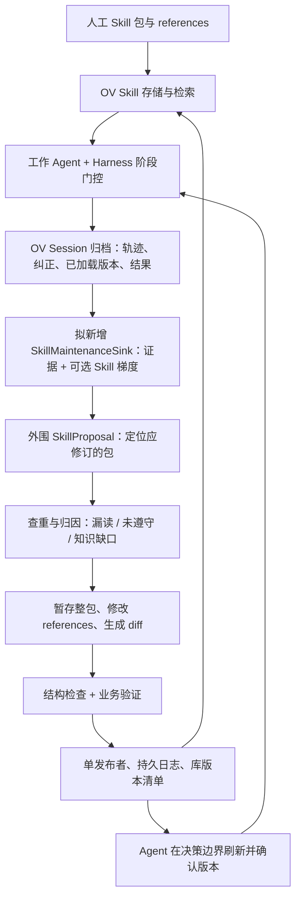

# feat/train_opt：Skill Evolution 能力复核

> **2026-10-10 版本补充与第一版决策：** `feat/train_opt` 不是最新的 Session Skill 维护实现。`main` 后续修复了 Skill 合并 schema 指向和安装器写入路径；实验分支 `feat/dag_exp_mode` 还把 Skill 抽取改为每个 Session 独立执行一次。逐段代码对比见 [Session Skill 维护链路：`main` 与 `feat/train_opt`](session-skill-maintenance-main-vs-train-opt.md)。第一版已选 [`main` 上的 Skill evolution detour](ov-skill-evolution-detour.md)；本文对 `feat/train_opt` 的描述是分支快照，不是 Experience 优先的实施建议。

## 结论与版本范围

**需要调整之前对 OpenSpace 的借鉴建议。`feat/train_opt` 已经实现了更完整的 Experience 提取、合并、质量检查、晋升、负反馈和并发更新。对这些环节，应优先复用 OV 的设计。** 但它仍未完成“人工 Skill 包 → 自动维护正文及 references → 共享发布 → 所有运行中 Agent 采用新版本”的完整链路。

2026-10-10 使用 `git ls-remote` 核对，远端 `feat/train_opt` 与本地跟踪引用均为 `0989989fe26de9445a0ff7902d5e9eb08a10ffd5`（2026-09-20，`merge opt_dt`）。原评估基于 `main@144033826`。二者已分叉，分别有 595 / 101 个独有提交；不能把该分支当成 main 的完整升级版。本文固定链接到被检查的提交，未切换工作区分支。

依据为实现、提示模板和测试源码；未运行完整模型训练、任务回放或多 Agent 联调。测试文件存在不代表此次执行通过。

## 先区分两种产物

| 产物 | 本场景角色 | 分支的实际覆盖 |
| --- | --- | --- |
| Skill 包：`SKILL.md + references/scripts` | 人工提供的一整套任务能力，需要整包修订和分发 | 保留原有 Skill 存储、管理接口和 Session Skill 更新器；未看到本分支新增完整的多文件合成链路 |
| Experience：结构化经验 Markdown | 从执行中学习适用条件、错误预防与修复经验，辅助后续 Agent | 本分支主要增强对象：训练默认写入用户 `memories/experiences`，由 loader 检索使用 |

Experience 模板要求 Situation、Reminder、Procedure、Verification、Fallback、Anti-pattern 六个部分，聚焦可控失败的预防或有证据的恢复；它明确约束泛泛成功总结和完整 SOP。因此，“新问题被解决”可能适合产生 Experience，但并不自动转化为新的 Skill 包。人工纠正也应携带实际证据和明确来源，不能直接等同于已验证恢复。

**补充：OV 并非只有 Skill 存储。** `memory.session_skill_extraction_enabled`（默认 `false`）打开后，Session commit 可从归档对话/轨迹抽取 `skill_gradients`，经 SkillSetLoader、PatchMergePolicyOptimizer、SkillPolicyUpdater 创建或修改当前用户的 `skills/{name}/SKILL.md`。抽取模板主要识别用户明确要求长期记住的规则、纠正和重复模式；这与从任意成功/失败轨迹自主维护共享任务库有范围差异。写入器可处理计划中的整个 Skill 目录删除，但当前抽取模板和公共调用并未形成经验证的共享库增改删闭环，也不维护 references/scripts 的任意变更。依据：[开关定义](https://github.com/volcengine/OpenViking/blob/0989989fe26de9445a0ff7902d5e9eb08a10ffd5/openviking_cli/utils/config/memory_config.py#L68)、[Session Skill 训练路径](https://github.com/volcengine/OpenViking/blob/0989989fe26de9445a0ff7902d5e9eb08a10ffd5/openviking/session/compressor_v3.py#L804)、[抽取模板](https://github.com/volcengine/OpenViking/blob/0989989fe26de9445a0ff7902d5e9eb08a10ffd5/openviking/prompts/templates/skill_extract/session_skills.yaml)、[Skill 写入器](https://github.com/volcengine/OpenViking/blob/0989989fe26de9445a0ff7902d5e9eb08a10ffd5/openviking/session/train/components/skill_policy_updater.py)。

依据：[Experience 模板](https://github.com/volcengine/OpenViking/blob/0989989fe26de9445a0ff7902d5e9eb08a10ffd5/openviking/prompts/templates/memory/experiences.yaml)、[批训练配置](https://github.com/volcengine/OpenViking/blob/0989989fe26de9445a0ff7902d5e9eb08a10ffd5/openviking/session/train/batch_runner.py)（`loader_mode` 默认 `skill`；默认 policy 根为用户 experiences）。相对共同祖先，`session/skill/`、Skill API router、`session_skills.yaml` 没有该分支独有改动。

## 对原需求的重新映射

| 用户要求 | feat/train_opt 已提供 | 仍需补齐 | 对 OpenSpace 借鉴的影响 |
| --- | --- | --- | --- |
| 从轨迹和纠正总结 | 轨迹分析、根因检查、Experience 六段结构、来源关联、门控拒绝及修复重试 | 采集人工纠正、实际加载的 Skill/revision；区分漏读、未遵守、规则错误；将经验转成包级提案 | 不必重建通用经验总结框架；证据契约仅补本场景字段 |
| 多 Agent 同类问题去重 | 检索候选、合并计划、来源合并；Cases 有多维语义兼容判断 | Skill 包的跨名称语义匹配、跨任务隔离、幂等提案、并发重复检查 | 优先借 OV 的语义合并原则；不移植 OpenSpace 名称相似去重 |
| 修改同步 | Memory updater 有目标版本预检、短锁、冲突重规划；Experience 有生命周期和召回过滤 | Skill 包发布条件写入、整库版本、通知、Agent 刷新与采用回执 | OpenSpace 同样没有解决全体工作 Agent 同步，仍需外围协议 |
| 插入位置 | metaskill + 查询/读取工具；benchmark 提供多种 loader；保留工具执行前提醒钩子 | Harness 强制阶段检查、版本感知、受影响上下文替换；新 Experience 到约束钩子的衔接 | 可直接参考 OV loader，无需整体引入 OpenSpace runtime |
| 维护人工包及 references | Skill 整包显式管理 API 仍可使用 | 候选工作区、多文件 diff、引用完整性、包级业务验证和发布恢复 | OpenSpace 的暂存编辑与提案流程仍最值得吸收 |

## 分支中值得优先复用的设计

### 1. 提取和合并之后都做质量检查

[GateRunner](https://github.com/volcengine/OpenViking/blob/0989989fe26de9445a0ff7902d5e9eb08a10ffd5/openviking/session/train/gates/runner.py) 提供统一决策、enforce/warn/shadow 模式、证据、可重试原因和修复提示。默认检查来源资格、结构和最终合并质量；合并涉及多来源或实质改写时，可以重新审查成品。它比只检查提取草稿更适合我们的维护链路。

需要保留适用范围：默认 gate 针对 `memory_type == experiences`，不能直接当成 Skill 包发布验证。结构检查和模型判断也不等同于执行候选包并对比业务效果。部分语义检查在模型异常时返回 warn，见 [根因语义 gate](https://github.com/volcengine/OpenViking/blob/0989989fe26de9445a0ff7902d5e9eb08a10ffd5/openviking/session/train/gates/root_cause_prevention.py)；接共享库时应明确异常是否允许发布。

### 2. 语义兼容比文本相似更适合作为去重依据

[PatchMergeContextProvider](https://github.com/volcengine/OpenViking/blob/0989989fe26de9445a0ff7902d5e9eb08a10ffd5/openviking/session/memory/patch_merge_context_provider.py) 将候选与已有项分组，约束 proposal 不被重复消费，再生成规范项及淘汰项。[Case 语义聚合](https://github.com/volcengine/OpenViking/blob/0989989fe26de9445a0ff7902d5e9eb08a10ffd5/openviking/session/memory/case_aggregation.py) 对 Cases 比较 goal、subject、action pattern、success boundary、context constraints：存在冲突不合并，关键维度未知也阻止自动合并。

这套思路比 OpenSpace 本地名称/描述相似更贴近需求，但 Cases 的实现不是现成的 Skill 去重器。适配时建议比较任务范围、触发条件、前提、操作步骤、验证条件及例外；相同错误表象但修复前提不同的候选应保持分离。

### 3. 经验质量由来源和使用反馈驱动

[Experience 生命周期](https://github.com/volcengine/OpenViking/blob/0989989fe26de9445a0ff7902d5e9eb08a10ffd5/openviking/session/memory/experience_lifecycle.py) 实现 draft → promoted，以及 degraded/archived。一次完整、成功且通过 rubric 的实际恢复可以晋升；否则通常需要两个独立轨迹来源。Agent 面向的召回只开放 promoted（兼容旧文件时，缺省状态按 promoted 处理）。degraded 不会因为普通追加来源自动恢复。

[Experience 反馈](https://github.com/volcengine/OpenViking/blob/0989989fe26de9445a0ff7902d5e9eb08a10ffd5/openviking/session/train/components/experience_feedback.py) 将使用后的反馈归属到具体经验；独立负面轨迹达到阈值可降级，负面来源 URI 会去重。可以复用“内容由模型生成，状态由代码维护”的原则。这里的来源数是晋升规则，不是对经验正确性的证明；也不能据此宣称整个训练作业已经具备跨进程幂等事务。

### 4. Memory 并发更新比之前更成熟

[MemoryFilePolicyUpdater](https://github.com/volcengine/OpenViking/blob/0989989fe26de9445a0ff7902d5e9eb08a10ffd5/openviking/session/train/components/policy_updater.py) 在具体写入目标上做版本预检与短锁；训练引擎遇到版本冲突后重新加载、重新规划。协调锁也收敛到专用锁文件。

但是 [SkillPolicyUpdater](https://github.com/volcengine/OpenViking/blob/0989989fe26de9445a0ff7902d5e9eb08a10ffd5/openviking/session/train/components/skill_policy_updater.py) 是另一条更新路径，未复用上述 Memory 版本冲突协议。Skill GET 的内容 revision 也不等于 PUT 支持 expected_revision 条件写入，更不等于多个包能原子发布。第一期继续采用单发布者；若有其他程序直接写共享根，外围单写者约定不足以防止冲突。

## 加载链路的一个重要断点

VikingBot 有两种 Experience 使用方式，需要与训练 benchmark 的主动工具分开看。普通消息构造时，`ContextBuilder.build_messages()` 可以自动检索并将全文作为一条 `role=user` 的 `[Experience Reminder]` 放在历史消息之后、当前用户消息之前；它不放进 system prompt。检索结果按相关性排序、按 `exp_recall_max_chars`（默认 10000 字符）裁剪，并按会话已召回 URI 去重。写入相关工具首次调用前还有一次独立的按需提醒，匹配后添加 `role=user` 消息，重新执行模型决策。

但普通自动召回当前先搜索 Case，再读取排名第一的 Case 所链接的 Experiences；`case_recall_limit` 默认 **0**，因此按默认配置不会从这条路径召回任何 Experience，也没有直接 Experience ANN 回退。将人工 Skill 直接存为 Experience 并不能保证其被自动加载。相关实现：[消息构造](https://github.com/volcengine/OpenViking/blob/0989989fe26de9445a0ff7902d5e9eb08a10ffd5/bot/vikingbot/agent/context.py#L438)、[Case 到 Experience 的自动召回](https://github.com/volcengine/OpenViking/blob/0989989fe26de9445a0ff7902d5e9eb08a10ffd5/bot/vikingbot/agent/memory.py#L749)、[默认配置](https://github.com/volcengine/OpenViking/blob/0989989fe26de9445a0ff7902d5e9eb08a10ffd5/bot/vikingbot/config/schema.py#L639)。

检索底层由 `VikingFS.search` 调用 `HierarchicalRetriever`：向量召回支持 dense/sparse；配置 reranker 时对候选重排，未配置时只用向量分数；有 Session 信息且开启 intent 时才会做查询意图分析。Case 自动召回使用当前用户消息作为查询并限制在用户的 `memories/cases/`。训练 benchmark 的主动工具另支持 Case ANN、Experience ANN、两路融合；默认 `case_ann`，属于该 benchmark 的适配逻辑，不能推断普通 VikingBot 默认也有三种模式。参见[底层检索](https://github.com/volcengine/OpenViking/blob/0989989fe26de9445a0ff7902d5e9eb08a10ffd5/openviking/storage/viking_fs/_semantic.py#L279)、[分层检索器](https://github.com/volcengine/OpenViking/blob/0989989fe26de9445a0ff7902d5e9eb08a10ffd5/openviking/retrieve/hierarchical_retriever.py#L101)、[benchmark 主动工具](https://github.com/volcengine/OpenViking/blob/0989989fe26de9445a0ff7902d5e9eb08a10ffd5/benchmark/tau2/train/rollout_executor_vikingbot.py#L260)。

[experience_loader 模板](https://github.com/volcengine/OpenViking/blob/0989989fe26de9445a0ff7902d5e9eb08a10ffd5/benchmark/tau2/train/experience_loader_template/SKILL.md) 已经非常接近我们讨论的 metaskill：业务动作前检索、按适用性读取全文、新子任务再检索、执行前重新核验条件。`search_experience` / `read_experience` 是此 benchmark/Harness 的工具封装，不能当作所有 OV 部署都自动暴露的公共 API。

VikingBot 的 [工具前提醒钩子](https://github.com/volcengine/OpenViking/blob/0989989fe26de9445a0ff7902d5e9eb08a10ffd5/bot/vikingbot/agent/loop.py#L1105) 在工具执行前可插入 Experience 提醒并让模型重新决策；但 [约束经验读取器](https://github.com/volcengine/OpenViking/blob/0989989fe26de9445a0ff7902d5e9eb08a10ffd5/bot/vikingbot/agent/memory.py#L672) 只选择带 `trigger_code` 的约束经验。与此同时，[Experience 生成提示](https://github.com/volcengine/OpenViking/blob/0989989fe26de9445a0ff7902d5e9eb08a10ffd5/openviking/session/memory/agent_experience_context_provider.py#L503) 明确要求不生成 `trigger_code`，[MemoryFilePolicyUpdater](https://github.com/volcengine/OpenViking/blob/0989989fe26de9445a0ff7902d5e9eb08a10ffd5/openviking/session/train/components/policy_updater.py) 写入 Experience 时还会移除这个字段。

**因此，本分支存在工具前提醒实现，但最新 Experience 合成默认没有自动产出它所需的触发代码。** 不能将其描述为“新经验一生成，所有 Agent 就会在正确动作前被强制提醒”。若需要这种效果，应另外实现条件编译/校验，或采用更简单的 Harness 阶段门控。metaskill 的必读文字本身仍依赖 Agent 遵守。

此外，提醒的会话内去重基于 URI，而不是内容 revision；该机制也没有提供所有 Agent 的版本采用确认。

## 第一版技术链：`main` 候选旁路，外围维护包

第一版直接交付“归档证据 → SkillProposal → 整包编写与验证 → OV 共享库发布 → Agent 采用”闭环。OV Skill 梯度只是提案提示，Experience 可作为独立的运行时记忆，但不是 Skill 更新的输入前提；新建、修改、明确授权的删除及 references 更新都由包级提案明确执行。

### 接口边界和接入成本

| 接入点 | 使用什么 | 性质与成本 |
| --- | --- | --- |
| 保存轨迹与触发提取 | OV Session 消息/commit 接口；拟新增 detour 模式和 `SkillMaintenanceSink` | Session API 可复用；候选出口需要窄幅 OV 改动，纠正与版本采集需 Harness 适配，中 |
| 可选的 Experience 补充 | `feat/train_opt` 内部 `session/train`、`session/memory` 组件 | 可独立使用；不是第一版 Skill 发布链路的前置依赖 |
| Skill 查询和完整包读取 | `/api/v1/skills`、`/api/v1/skills/find`、GET 单包及 `include_integrity=true` | 公共 Skill API；保存 revision 和文件哈希，低 |
| Skill 校验/更新/删除 | `/api/v1/skills/validate`、PUT/DELETE `/api/v1/skills/{skill_name}` | 明确目标与共享 URI，沿用包管理接口；业务验证和条件发布仍需补，中 |
| 整包维护 | 独立 SkillProposal、候选目录、diff、引用检查、任务验收插件 | 借鉴 OpenSpace `StagedSkillEdit`，不接其整套 runtime，中 |
| 共享和同步 | 外围 task library manifest、release log、Harness revision 检查/回执 | 两边都未完整满足；一个 Harness 中，多 Harness/多机更高 |

`Session.commit` 的普通会话提取不应被描述成默认自动运行完整 benchmark 训练/评估流水线。`SkillMaintenanceSink` 是第一版拟新增的内部出口，不是现有公共 API；正式包仍通过 OV 公共 Skill API 发布。

## OpenSpace 借鉴优先级修订

| 设计 | 本次建议 |
| --- | --- |
| 通用经验提炼、门控、修复重试 | **降级**：优先用 train_opt 已有结构，补 Skill 包专用检查 |
| 经验生命周期、负反馈、语义合并 | **优先参考 OV**；OpenSpace 不构成明显能力优势 |
| EvidencePacket / DecisionRationale | **精简吸收**：补人工纠正、Skill 使用版本、提案证据水位与归因，不重建整套轨迹系统 |
| StagedSkillEdit、多文件 diff、intent_spec | **仍优先吸收**：直接覆盖人工包和 references 维护缺口 |
| 持久作业、幂等决策、提交日志与恢复 | **仍需**：以包级发布为边界，复用原则即可，无需复制调度系统 |
| 行为验证 | **仍需包级接入**：借验收契约，按任务提供验证插件；不把 Experience gate 等同于业务回放 |
| 完整 runtime、registry、名称相似去重 | **不建议移植**：成本高，仍不能补齐全局语义去重和采用同步 |

## 仍需验证的 Skill 专属问题

原文档指出的 `PolicySet.reload()` 固定使用 ExperienceSetLoader，在这个分支中仍存在；`optimize_search_result()` 仍只提取 `memories`，未处理 `skills`。Skill 更新器仍集中修改正文元数据，不能完成 references 的任意增删改。对应代码：[PolicySet.reload](https://github.com/volcengine/OpenViking/blob/0989989fe26de9445a0ff7902d5e9eb08a10ffd5/openviking/session/train/domain.py#L104)、[搜索结果裁剪](https://github.com/volcengine/OpenViking/blob/0989989fe26de9445a0ff7902d5e9eb08a10ffd5/openviking/session/memory/tools.py#L45)、[SkillOperationUpdater](https://github.com/volcengine/OpenViking/blob/0989989fe26de9445a0ff7902d5e9eb08a10ffd5/openviking/session/skill/skill_operation_updater.py)。

这些静态问题意味着：不能直接把 Experience 的成熟度外推给内部 Skill trainer。第一版 detour 不让内部 Skill trainer 写正式库，因此这些是将来启用 direct 路径的前置修复，不是第一版的阻塞项。

第一版按以下顺序实施：固定 `main` 基线及公共 API 契约；新增无 Case 也提交证据的候选出口和提案回执；落地一个 Harness 的纠正、已加载版本采集及阶段门控；完成外围整包提案、去重、验证、单发布者与采用回执。验收重点是同类问题只修订一次、漏读不会误造新技能、reference 与正文一致、并发不会覆盖更新、工作 Agent 在下一决策边界报告并使用新版本。

**不为了复用这些能力直接合并整个长期分叉分支。** 第一版以 `main` 为基线；若以后需要 Experience 补充，再选择性适配该分支的设计或模块并检查依赖。门控、训练、存储并非完全独立，不能假定复制几个类就能运行。

## 曾考虑的两阶段方案与 OpenSpace worker 的取舍

曾考虑先让 OpenSpace 离线修订人工 Skill 包，再由 OV Experience 链路承担运行中的补充。这适合准备人工基础包，但“基础包固定 + 经验持续增加”不满足在线 Skill 增改删，且长期存在双份规则风险。第一版直接导入人工完整包，并从真实任务轨迹进入 detour；无需先完成离线 OpenSpace 阶段，也不依赖 Experience 的自动召回。

在线接入 OpenSpace 更适合做独立的“提案 worker”，由它在隔离候选目录里修改包、输出 diff/引用变更/验证报告，最终仍由一个发布器写 OV 并推进任务库版本。现成 CLI 的 `openspace -q` 是执行任务入口；[MCP `execute_task`](https://github.com/HKUDS/OpenSpace/blob/38277815ed44a53d757973c2bc4454c3b6426698/openspace/entrypoints/mcp/server.py) 会让 OpenSpace 自己执行任务并自动分析，[`fix_skill(skill_dir, direction)`](https://github.com/HKUDS/OpenSpace/blob/38277815ed44a53d757973c2bc4454c3b6426698/openspace/entrypoints/mcp/server.py) 只提供已知 Skill 的手动 FIX，并会经内部流程提交本地修改。它们都不是“输入 VikingBot 既有轨迹与人工纠正 → 输出新增/修订/删除提案、不修改正式库”的现成接口。OpenSpace 的内部 TriggerJob 支持手动 capture/derive，但仍需导入外部轨迹、证据水位、Skill 版本和修订目标的适配；删除也不在已检查的 FIX/DERIVED/CAPTURED 提交流程内。

第一版按以下闭环验收：

1. 人工完整包导入 OV；工作 Agent 按任务阶段强制读取正式 Skill，并记录包 revision。
2. 两个 Agent 对同类问题产生证据；OV detour 在无 Case 时仍提交一次证据；外围 worker 归因、去重、整包暂存并用失败与正常用例验证。
3. 单发布者把一个包的变更发布到共享根，推进库清单；运行中 Agent 在下一决策边界刷新并回报采用 revision。新建包和明确授权的删除也走同一协议。

目前没有证据表明 OV 在 Skill 或 Experience 更新时，会主动广播新内容到所有在途 Agent 并确认采用。VikingBot 远程 Skill 在请求边界重新发现和验证包版本，Experience 则在消息构造或特定工具边界检索；这是**边界处刷新**，仍需 Harness 的任务库版本、失效通知或轮询，以及采用回执。不要把共享存储可见性当作广播保证。[VikingBot 远程 Skill 适配](https://github.com/volcengine/OpenViking/blob/0989989fe26de9445a0ff7902d5e9eb08a10ffd5/bot/vikingbot/agent/remote_skills.py)、[Experience 自动召回](https://github.com/volcengine/OpenViking/blob/0989989fe26de9445a0ff7902d5e9eb08a10ffd5/bot/vikingbot/agent/memory.py#L749)。

相关文档：[原始链路与接口清单](multi-agent-skill-evolution.md)、[OpenSpace 设计借鉴评估](openspace-skill-evolution-assessment.md)。
